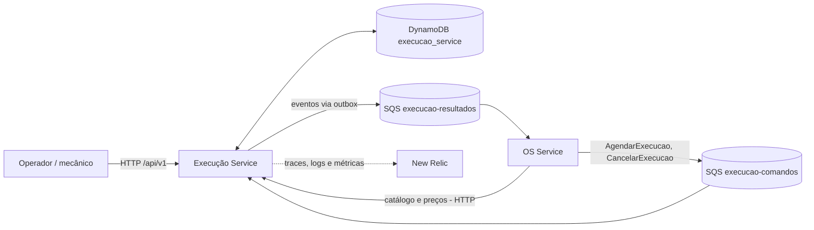

# Execucao Service

Microsservico de Execucao e Producao da Oficina FIAP (Tech Challenge Fase 4).

## Responsabilidade

Gerencia a fila de execucao da ordem de servico, atualiza o status durante diagnostico e
reparos, avisa o OS Service ao finalizar, e mantem o catalogo de servicos e o estoque de
pecas.

## Tecnologias

- Java 21
- Spring Boot 4.0.5
  - Spring Web, Validation, Actuator
- AWS SDK v2
  - SQS (consumo de comandos e publicação de eventos da Saga)
  - DynamoDB (tabela única com execuções, diagnósticos, catálogo, estoque e outbox)
- Micrometer, Prometheus e OpenTelemetry (métricas e traces para o New Relic), logs em JSON com `logstash-logback-encoder`
- springdoc-openapi (Swagger UI)
- Lombok
- Maven + Maven Wrapper
- JUnit, Mockito, Cucumber e Testcontainers (testes unitários e BDD)
- JaCoCo (cobertura de testes, com trava de 80%) e SonarCloud (análise de qualidade no CI)

## Arquitetura do serviço

O Execução é um dos três microsserviços da oficina, ao lado do OS Service e do Billing Service. A visão da solução inteira está no [diagrama geral da arquitetura](docs/arquitetura-geral-fase4.md), e as decisões que levaram a ela estão nos [ADRs da Fase 4](docs/decisoes-fase4/README.md).



**Por que um serviço separado:** catálogo e estoque ficam com quem usa as peças no dia a dia (ADR-P1). Isso permite reservar as peças e agendar o trabalho numa única transação, sem depender de outro serviço.

**Por que DynamoDB:** o desafio exige um banco NoSQL. Os dados da execução variam (diagnóstico com versões, reservas, operações processadas, outbox), e o DynamoDB é gerenciado pela AWS, o que evita manter um banco dentro do cluster de nó único (ADR-P2).

**Organização do código (camadas, como nas fases anteriores):**

| Camada | Conteúdo |
| --- | --- |
| `domain/model` | Execução, diagnóstico, item de catálogo e suas regras (transições de status, validações). |
| `application` | Casos de uso (`ExecucaoService`), interfaces de persistência, outbox e métricas de negócio. Não conhece AWS nem HTTP. |
| `adapter/in/web` | API HTTP: catálogo, estoque, diagnóstico, cotação e fila de trabalho. |
| `adapter/in/sqs` | Consumidor dos comandos da fila `execucao-comandos`. |
| `adapter/out/dynamodb` | Persistência em tabela única (`pk`/`sk`), com transações para manter estoque, execução, operação e evento sempre juntos. |
| `adapter/out/sqs` | Publicador da outbox para a fila `execucao-resultados`, e métricas das filas. |
| `contract` | Formato dos comandos recebidos e validação do envelope. |
| `config` | Clientes AWS, agendamentos e observabilidade (`config/observability`). |

Detalhes (estados, chaves do DynamoDB, outbox e filas) em [docs/arquitetura-execucao.md](docs/arquitetura-execucao.md).

## Saga: estratégia e papel do Execução

**Estratégia escolhida: Saga orquestrada**, com o orquestrador dentro do OS Service (ADR-P4). O OS guarda o estado da Saga e decide o próximo passo a cada evento. Os participantes (Billing e Execução) só executam comandos e respondem com eventos.

**Por que orquestrada, e não coreografada:**

- Um único lugar descreve o fluxo inteiro, o que facilita depurar, testar e mostrar em que passo cada OS está.
- Os participantes não precisam conhecer uns aos outros: o Execução só conversa com o OS, pelas suas duas filas.
- A coreografia é mais desacoplada, mas espalha a regra do fluxo pelos três serviços e fica mais difícil de acertar e de compensar com o prazo da fase.

**Papel do Execução na Saga:**

| Comando recebido (`execucao-comandos`) | Resultado publicado (`execucao-resultados`) |
| --- | --- |
| `AgendarExecucao`, depois do pagamento confirmado | `ExecucaoAgendada` (peças reservadas e trabalho na fila) ou `ExecucaoRejeitada` (falta de peça, sem reserva parcial) |
| `CancelarExecucao` (compensação) | `ExecucaoCancelada` (peças devolvidas ao estoque) ou `CancelamentoExecucaoRecusado` (o reparo já começou) |
| Ações do mecânico pela API (sem comando) | `ExecucaoIniciada` e `ExecucaoConcluida` |

**Como o Execução apoia as compensações:**

- `ExecucaoRejeitada` é o gatilho para o OS estornar o pagamento e cancelar a OS. Como a reserva é atômica, não sobra estoque preso.
- `CancelarExecucao` devolve as peças uma única vez, mesmo que o comando chegue repetido.
- Trabalho já iniciado não é desfeito automaticamente: o Execução responde `CancelamentoExecucaoRecusado` e a decisão volta para o OS.

**Garantias de entrega:**

- **Idempotência:** cada comando é registrado pelo `operationId`. Uma repetição devolve o mesmo resultado, sem mexer no estoque de novo.
- **Outbox transacional:** o evento é gravado na mesma transação da mudança (estoque, execução e operação) e publicado depois, com `messageId` determinístico.
- **DLQ:** mensagens inválidas vão para a DLQ em segundos; falhas temporárias são tentadas de novo até 5 vezes.
- **Rastreamento:** o contexto do trace (`traceparent`) atravessa as filas, então a Saga aparece como um trace só no New Relic.

Contratos completos (envelopes, campos e exemplos) no [guia de integração](docs/contrato-provisorio-saga.md), e o fluxo de negócio passo a passo em [docs/fluxo-de-negocio.md](docs/fluxo-de-negocio.md).

## Como rodar localmente

Pre-requisitos: Java 21.

```bash
./mvnw clean verify
./mvnw spring-boot:run
```

No Windows (PowerShell/cmd):

```
mvnw.cmd clean verify
mvnw.cmd spring-boot:run
```

Variaveis de ambiente configuraveis (ver `src/main/resources/application.yaml`):

| Variavel | Default | Descricao |
|---|---|---|
| `AWS_REGION` | `us-east-1` | Regiao AWS usada pelos clientes SQS/DynamoDB |
| `DYNAMODB_ENDPOINT_URL` | vazio | Endpoint opcional do DynamoDB local |
| `SQS_ENDPOINT_URL` | vazio | Endpoint opcional do SQS local |
| `DYNAMODB_TABLE_NAME` | `execucao_service` | Nome da tabela DynamoDB |
| `SQS_EXECUCAO_RESULTADOS_URL` | vazio | URL da fila de resultados |
| `SQS_EXECUCAO_COMANDOS_URL` | vazio | URL da fila de comandos |
| `SQS_CONSUMER_ENABLED` | `false` | Ativa o consumidor após configurar a fila de comandos |
| `SQS_CONSUMER_POLL_DELAY_MS` | `5000` | Intervalo entre leituras da fila de comandos |
| `SQS_CONSUMER_MAX_MESSAGES` | `10` | Mensagens lidas por vez da fila de comandos (1 a 10) |
| `MANAGEMENT_SERVER_PORT` | `8081` | Porta do Actuator (health e métricas Prometheus) |
| `SQS_METRICS_ENABLED` | `false` | Liga as métricas de quantidade de mensagens nas filas e DLQs |
| `SQS_METRICS_POLL_DELAY_MS` | `60000` | Intervalo entre as consultas de métricas ao SQS |
| `SQS_EXECUCAO_COMANDOS_DLQ_URL` | vazio | URL da DLQ de comandos (só para métricas) |
| `SQS_EXECUCAO_RESULTADOS_DLQ_URL` | vazio | URL da DLQ de resultados (só para métricas) |
| `SPRING_PROFILES_ACTIVE` | vazio | `newrelic` exporta os traces para o New Relic (requer `NEW_RELIC_LICENSE_KEY`) |
| `NEW_RELIC_LICENSE_KEY` | vazio | License key de ingestão do New Relic |
| `TRACING_SAMPLING_PROBABILITY` | `1.0` | Fração de traces amostrados |
| `OUTBOX_PUBLISHER_ENABLED` | `false` | Ativa o publicador após configurar a fila |
| `OUTBOX_POLL_DELAY_MS` | `5000` | Intervalo entre buscas na outbox |

No cluster, o workflow de deploy grava essas variáveis no ConfigMap `execucao-service-config`: as URLs das filas e DLQs são montadas a partir de `SQS_BASE_URL` (variável de repositório opcional, padrão `https://sqs.us-east-1.amazonaws.com/381492182695`) e o consumidor, o publicador e as métricas das filas ficam ligados. As credenciais AWS vêm do perfil da instância, sem chaves no ConfigMap.

Health check: `GET :8081/actuator/health`. Métricas Prometheus: `GET :8081/actuator/prometheus` (detalhes em [observabilidade](docs/observabilidade.md)).

## Contratos

- [Fluxo de negócio: quem chama o quê e o que muda cada status](docs/fluxo-de-negocio.md)
- [Como o serviço funciona: endpoints, consumo e publicação de mensagens](docs/funcionamento-do-servico.md)
- [Observabilidade: métricas de negócio, pod, CPU e limites](docs/observabilidade.md)
- [Collection do Postman com o fluxo completo](docs/execucao-service.postman_collection.json)
- [Arquitetura do Execução Service e configuração das DLQs](docs/arquitetura-execucao.md)
- [Guia de integração para OS Service e Billing: filas, mensagens, campos e HTTP](docs/contrato-provisorio-saga.md)
- [Diagrama geral da arquitetura da Fase 4 (os três serviços, bancos e comunicação)](docs/arquitetura-geral-fase4.md)
- [ADRs da Fase 4: decisões de arquitetura P1 a P7](docs/decisoes-fase4/README.md)

## Qualidade: cobertura e Sonar

### Cobertura de testes

O JaCoCo mede a cobertura e o build (`./mvnw clean verify`) **falha se a cobertura de linhas ficar abaixo de 80%** (`jacoco.minimum.coverage` no `pom.xml`). O relatório HTML fica em `target/site/jacoco/index.html`.

| Medida (08/11/2026) | Valor |
| --- | --- |
| Testes automatizados (unitários + 5 cenários BDD) | 151 |
| Cobertura de linhas (JaCoCo, usada no gate) | 94,1% |
| Cobertura de instruções (JaCoCo) | 93,8% |
| Cobertura segundo o Sonar (linhas + branches) | [painel no SonarCloud](https://sonarcloud.io/project/overview?id=pisanohub_oficina-fiap-execucao-service) |

### Testes BDD (Cucumber)

O fluxo completo do serviço está descrito em português, no formato Gherkin, em [`src/test/resources/features/execucao.feature`](src/test/resources/features/execucao.feature) e é executado como teste automatizado. Os cenários cobrem:

1. **Fluxo completo:** o OS Service agenda a execução, o mecânico inicia e conclui, com os eventos `ExecucaoAgendada`, `ExecucaoIniciada` e `ExecucaoConcluida` publicados.
2. **Agendamento rejeitado** por falta de estoque (`ExecucaoRejeitada`, sem execução criada e sem mexer no estoque).
3. **Cancelamento antes do início**, que devolve as peças ao estoque (`ExecucaoCancelada`).
4. **Cancelamento recusado** depois que o trabalho começou (`CancelamentoExecucaoRecusado`).
5. **Rastreamento:** o `traceparent` do comando atravessa o consumo, a chamada HTTP do mecânico e os eventos publicados, todos no mesmo trace.

Os passos (`src/test/java/.../bdd`) não usam dublês: o teste sobe o **DynamoDB Local e o ElasticMQ em containers** (Testcontainers), inicia a aplicação inteira com o consumidor e o publicador ligados e conversa com ela como o OS Service e o mecânico fariam, por mensagens no SQS e chamadas HTTP.

```bash
./mvnw test -Dtest=CucumberTest        # só o BDD
./mvnw clean verify                    # tudo (inclui o BDD)
```

Requer **Docker** em execução. Sem Docker, os cenários são ignorados na máquina local, mas **falham no CI** (variável `CI`), para não passarem em branco. O relatório fica em `target/cucumber-reports/cucumber.html`.

### Sonar

O projeto está configurado para o SonarQube/SonarCloud (`sonar-maven-plugin` e propriedades `sonar.*` no `pom.xml`, usando o relatório do JaCoCo). O CI do PR #22 rodou a análise no SonarCloud e o *quality gate* passou. Na análise local de 03/11/2026 com o SonarQube Community, com 0 bugs, 0 vulnerabilidades, 0 *code smells*, 0 *security hotspots*, 0% de duplicação e nota A em confiabilidade, segurança e manutenibilidade.

Análise local, com um SonarQube em `localhost:9000` (token gerado no próprio SonarQube):

```bash
docker run -d --name sonarqube -p 9000:9000 sonarqube:community
./mvnw clean verify
./mvnw sonar:sonar -Dsonar.host.url=http://localhost:9000 -Dsonar.token=SEU_TOKEN -Dsonar.qualitygate.wait=true
```

No CI (`.github/workflows/ci.yml`), a mesma etapa roda os testes, a trava de cobertura do JaCoCo e a análise do Sonar (`verify` + `sonar:sonar`, no mesmo padrão do OS Service e do Billing). O `-Dsonar.qualitygate.wait=true` faz o job **falhar se o quality gate do Sonar reprovar**, e a regra do JaCoCo faz falhar se a cobertura de linhas ficar abaixo de 80%.

A configuração fica no próprio repositório: a organização (`sonar.organization`) e o servidor (SonarCloud) no `pom.xml`, e a chave do projeto no comando do `ci.yml`. O **único** item externo é o secret `SONAR_TOKEN` do repositório (Settings > Secrets and variables > Actions). Sem ele, a etapa do Sonar falha.

Para o Sonar e a cobertura **barrarem o merge**, o check `build-test` precisa ser marcado como obrigatório na proteção da branch `main`.

## Estado atual

O serviço está funcional e coberto por testes. Resumo do que existe na `main`:

- **API HTTP** (`/api/v1`): catálogo e estoque (listar, consultar, atualizar, inativar, repor e ajustar), diagnóstico com controle de versão, cotação de preços e fila de trabalho (listar com paginação, consultar, iniciar e concluir).
- **Mensageria**: consumo de `AgendarExecucao` e `CancelarExecucao` e publicação dos resultados via outbox, ambos ligados por configuração (`SQS_CONSUMER_ENABLED` e `OUTBOX_PUBLISHER_ENABLED`) e ativos no deploy, que já aponta para as filas reais.
- **Persistência**: DynamoDB, com agendamento, deduplicação e outbox numa única transação.
- **Observabilidade**: métricas de negócio, filas e limites do container em Prometheus (porta 8081), traces OpenTelemetry com o contexto atravessando o SQS e logs em JSON correlacionados (`trace.id`, `os.id`, `saga.id`).
- **Qualidade**: 151 testes, cobertura de 80% e análise do Sonar barrando o CI.

Próximas etapas do serviço:

- Alinhar com o grupo os contratos e a orquestração do cancelamento e do estorno.
- Autenticação e autorização para operadores e serviços nas rotas `/api/v1`.
- Validar o fluxo na AWS: permissão da LabRole para SQS e DynamoDB no cluster.
- Dashboard e alertas no New Relic.
