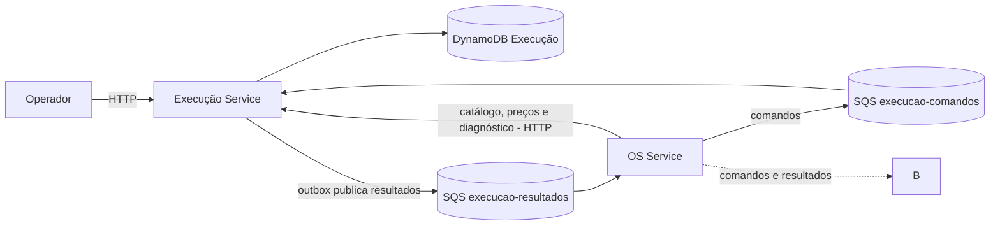
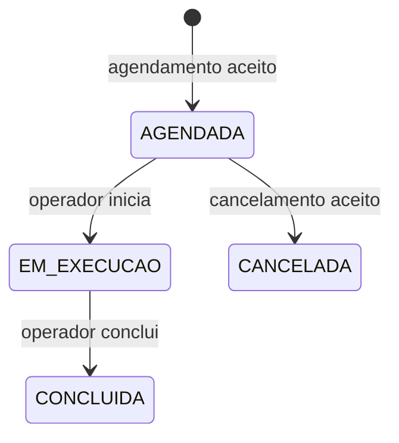

# Arquitetura do Execução Service

Este documento descreve a implementação disponível na `main` e as integrações propostas para a Fase 4. Os contratos entre serviços e a infraestrutura compartilhada ainda precisam ser validados pelo grupo. Para campos, exemplos HTTP e mensagens, consulte o [contrato provisório da Saga](contrato-provisorio-saga.md).

## Contexto e responsabilidades

O `oficina_fiap` é o monólito de referência. Na divisão em serviços, o OS Service é responsável pelo ciclo da ordem de serviço e pela orquestração; o Billing Service cuida do orçamento e pagamento; o Execução Service mantém diagnóstico, catálogo, estoque e execução do trabalho. O Execução Service não altera o banco ou o status da OS diretamente.

No monólito, as mudanças de status e a manipulação dos itens ocorrem dentro da mesma aplicação. Na arquitetura distribuída, cada serviço persiste seus dados e se comunica por HTTP ou mensagens. O desenho abaixo mostra responsabilidades e integrações propostas; a disponibilidade das integrações nos outros serviços deve ser verificada com seus responsáveis.

O grupo tem seis filas, cada uma com DLQ, criadas pelo Pedro no `oficina-fiap-infra-k8s`: `gerar-orcamento`, `orcamento-respondido`, `processar-pagamento`, `pagamento-confirmado`, `execucao-comandos` e `execucao-resultados`. O Execução usa só as duas últimas. A visão da solução inteira está no [diagrama geral da arquitetura](arquitetura-geral-fase4.md) e as decisões nos [ADRs da Fase 4](decisoes-fase4/README.md).

O Billing não chama o Execução: pelo ADR-P4, o OS guarda o preço de cada item (snapshot) ao montar a OS e o envia no comando `GerarOrcamento`. A rota de cotação (`POST /api/v1/cotacoes`) continua disponível para o OS consultar os preços.

## Fluxo de negócio

1. O cliente abre a OS no OS Service. A abertura não dispara orçamento.
2. O operador inicia o diagnóstico e registra peças e serviços no Execução Service. O diagnóstico guarda identificadores, quantidades e versão.
3. Na ação explícita de solicitar orçamento, o OS envia ao Billing o comando `GerarOrcamento` com os itens e o preço de cada um, capturado do catálogo do Execução quando o item foi adicionado (snapshot, ADR-P4).
4. Após aprovação e confirmação de pagamento, o OS envia `AgendarExecucao`. Execução reserva as peças e registra a execução como `AGENDADA`.
5. O operador inicia e conclui o trabalho pelas rotas HTTP; Execução registra `EM_EXECUCAO` e depois `CONCLUIDA`, publicando os respectivos eventos.
6. O OS recebe os eventos e decide a transição do estado da OS. A entrega do veículo pertence ao fluxo da OS.

O grupo ainda precisa decidir em que momento a OS muda para `EM_EXECUCAO`: o desenho informado coloca a OS nesse estado após o pagamento, enquanto no monólito esse estado marca o início do trabalho. O estado da execução é próprio do Execução Service.

## Organização do código

| Local | Função |
| --- | --- |
| `domain/model` | Modelos de diagnóstico, catálogo e execução e validações locais. |
| `application` | Casos de uso e interfaces de persistência. |
| `adapter/in/web` | Controlador HTTP e tratamento de erros. |
| `adapter/in/sqs` | Leitura e encaminhamento dos comandos recebidos na fila. |
| `adapter/out/dynamodb` | Persistência DynamoDB. `DynamoExecucaoRepository` implementa a interface da aplicação e delega agendamento, ciclo da execução, diagnóstico e catálogo a classes próprias; `DynamoOutboxRepository` lê e confirma eventos. `DynamoKeys` e `DynamoRepositorySupport` compartilham convenções de chave e operações básicas. |
| `adapter/out/sqs` | Publicação dos eventos de resultado no SQS. |
| `contract` | Estruturas dos comandos recebidos. |
| `config` | Configuração dos clientes AWS, relógio e agendamentos. |
| `config/observability` | Correlação das requisições, observação das mensagens SQS (traces) e métricas do container. Ver [observabilidade.md](observabilidade.md). |
| `terraform` | Definição da tabela DynamoDB presente neste repositório. |

## Estados da execução

O cancelamento de execução já iniciada ou concluída é recusado. No caso agendado, as peças são devolvidas; uma repetição não devolve o estoque novamente. Execução rejeitada por estoque insuficiente não cria um registro de execução. Execução inexistente no cancelamento permanece sem resultado de negócio definido: o comando falha e fica sujeito a nova tentativa e à DLQ configurada.

## DynamoDB

O serviço usa uma tabela com `pk` e `sk` do tipo string. O Terraform deste repositório define a tabela `execucao_service`, sem índice secundário declarado no arquivo atual. O código também permite configurar o nome da tabela.

| Informação | `pk` | `sk` |
| --- | --- | --- |
| Diagnóstico | `OS#{osId}` | `DIAGNOSTICO` |
| Execução | `OS#{osId}` | `EXECUCAO` |
| Peça ou serviço de catálogo | `PECA#{itemId}` ou `SERVICO#{itemId}` | `CADASTRO` |
| Operação de agendamento | `OPERACAO#{operationId}` | `AGENDAMENTO` |
| Operação de cancelamento | `OPERACAO#{operationId}` | `CANCELAMENTO` |
| Evento pendente ou publicado | `OUTBOX#{operationId}` | `RESULTADO` |

O desenho atual mantém uma execução por OS. O agendamento usa uma transação para descontar peças, criar a execução, registrar a operação e salvar o evento na outbox. A conclusão e o início gravam o estado e o evento juntos. O cancelamento aceito grava a mudança, a devolução das peças, a operação e o evento juntos.

## Comunicação e outbox

O consumidor SQS processa `AgendarExecucao` e `CancelarExecucao`. A mensagem só é removida após o processamento bem-sucedido, incluindo o registro de uma rejeição de negócio. Quando há falha, ela fica sujeita a nova entrega e à política de DLQ configurada na infraestrutura.

A outbox é um registro de eventos no DynamoDB. Um publicador procura eventos pendentes, reserva cada registro temporariamente e o envia para `execucao-resultados`. Após o SQS confirmar o envio, o evento é marcado como publicado. Se o envio for confirmado pelo SQS e a marcação no DynamoDB falhar, uma nova tentativa pode gerar duplicata. O consumidor deve tratar duplicatas; a ordem de entrega entre eventos também não é garantida.

`operationId` deve permanecer igual em tentativas da mesma operação e ser diferente para operações distintas. O formato exato dos envelopes e a política de consumo pelo OS estão no [contrato](contrato-provisorio-saga.md).

## HTTP e acesso

As rotas usam o prefixo `/api/v1` para catálogo, diagnóstico, cotação e fila de trabalho. Elas estão listadas no contrato, com exemplos de requisição e resposta. O Actuator (`/actuator/health` e `/actuator/prometheus`) fica na porta de gerenciamento 8081, separada da API; as métricas estão em [observabilidade.md](observabilidade.md).

A autenticação e a autorização de operadores e serviços ainda precisam ser implementadas e alinhadas com o Gateway e a solução de autenticação do grupo. O prefixo da rota, por si só, não aplica controle de acesso.

## Execução local e configuração

O mesmo código é usado localmente e no ambiente do grupo. URLs de DynamoDB e SQS locais são opcionais e configuradas por variáveis; não há um controlador separado para execução local. O [README](../README.md) lista os comandos Maven e as variáveis disponíveis. Para testar filas, é necessário criar a tabela e as filas, definir seus endpoints e URLs e habilitar o consumidor e o publicador; as configurações não criam os recursos automaticamente.

A suíte automatizada é executada com `./mvnw clean verify`. O fluxo foi exercitado com DynamoDB e SQS locais chamando os componentes do serviço; isso não comprova, por si só, a integração entre os microsserviços implantados ou a proteção das rotas HTTP.

## Limitações e decisões pendentes

- Consulta da fila de trabalho e busca da outbox fazem `Scan` na tabela. A listagem de execuções aceita paginação opcional (`limite` e `pagina`); o índice secundário foi avaliado (ver [funcionamento-do-servico.md](funcionamento-do-servico.md)) e fica para quando o volume crescer.
- O consumidor e o publicador são desabilitados por padrão na aplicação. O deploy (`.github/workflows/deploy.yml`) já configura as URLs das quatro filas e liga o consumidor, o publicador e as métricas das filas; falta confirmar na prática que a LabRole do nó tem permissão de SQS e DynamoDB.
- A sincronização do status da OS e os contratos de mensagens precisam de validação conjunta. As quatro filas já existem na AWS (criadas pelo Pedro).
- A ordem do cancelamento e do estorno, e a resposta para cancelamento sem execução existente, permanecem para acordo com o grupo.
- Cancelamento após início do trabalho e tratamento de peças já utilizadas não fazem parte da regra atual.
- As políticas de acesso precisam ser verificadas no ambiente compartilhado: o pod usa as credenciais do perfil da instância EC2 (`LabInstanceProfile`), sem chaves estáticas. Um `AccessDenied` nos logs do deploy indica falta de permissão da LabRole.

## Filas e DLQs

As quatro filas (`execucao-comandos`, `execucao-comandos-dlq`, `execucao-resultados` e `execucao-resultados-dlq`) foram criadas pelo Pedro na conta e região do grupo (`us-east-1`) e pertencem ao repositório de infraestrutura `oficina-fiap-infra-k8s`. Este repositório **não** define filas em Terraform, para que um único estado seja dono de cada recurso. A configuração aplicada pela infraestrutura é visibilidade de 30 segundos e `maxReceiveCount = 5`: uma mensagem não confirmada vai para a DLQ após 5 recebimentos. Os demais parâmetros (retenção das DLQs, espera longa) devem ser consultados no repositório de infraestrutura. A DLQ de resultados recebe falhas do consumidor OS Service, não falhas de publicação pelo Execução Service.

Configure `SQS_EXECUCAO_COMANDOS_URL` e `SQS_EXECUCAO_RESULTADOS_URL` com as URLs das filas principais (formato `https://sqs.us-east-1.amazonaws.com/<conta>/<nome-da-fila>`) e habilite os componentes correspondentes.

No cluster, o deploy faz isso no ConfigMap `execucao-service-config`: monta as URLs das filas principais e das DLQs a partir de `SQS_BASE_URL` (variável de repositório opcional; o padrão é `https://sqs.us-east-1.amazonaws.com/381492182695`) e liga `SQS_CONSUMER_ENABLED`, `OUTBOX_PUBLISHER_ENABLED` e `SQS_METRICS_ENABLED`. O Deployment carrega um checksum do ConfigMap no template, então qualquer mudança nessas variáveis reinicia os pods. Depois do rollout, o workflow mostra as últimas 50 linhas de log do pod para expor erros de permissão.

No teste local com ElasticMQ, uma mensagem não confirmada é encaminhada à DLQ após o número de recebimentos configurado no emulador. Esse teste verifica o redirecionamento, e não substitui a verificação da configuração na AWS.
