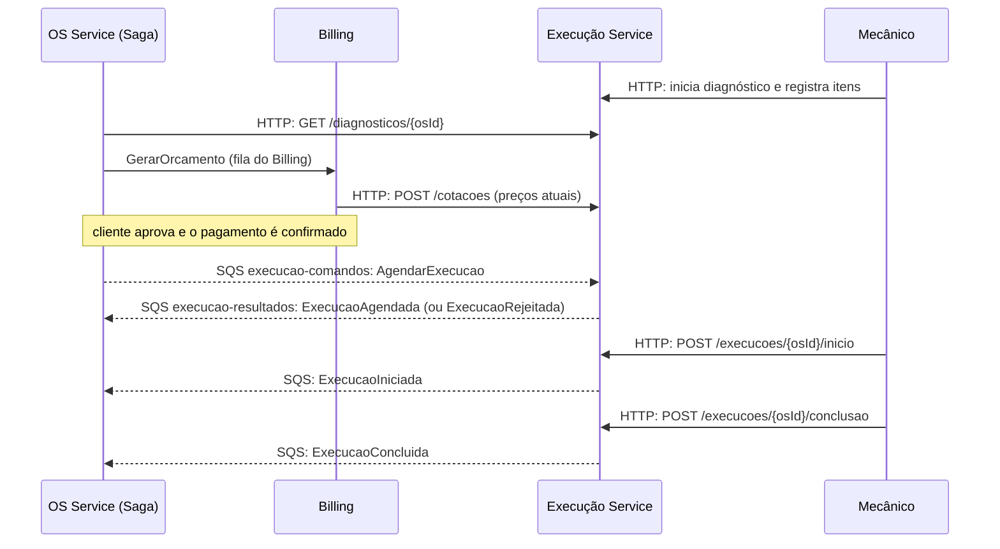

# Guia de integração com o Execução Service

**Para quem é:** Gabriel Souza (OS Service / orquestrador da Saga) e Gabriel Ramos (Billing Service).
**Status:** contrato **provisório**, implementado no Execução Service e ainda a validar com os dois. Tudo o que está aqui descreve o que o código **já faz hoje**; os pontos em aberto estão na [última seção](#10-pontos-em-aberto-para-validar).

Este documento responde, para quem vai chamar o Execução: **o que enviar, para onde, em que formato, o que cada campo significa, o que volta e o que acontece quando algo dá errado.** Para a visão interna do serviço, veja [funcionamento-do-servico.md](funcionamento-do-servico.md) e [arquitetura-execucao.md](arquitetura-execucao.md).

---

## 1. Resumo em um minuto

O Execução Service cuida de **diagnóstico, catálogo/estoque de peças e fila de trabalho do mecânico**. Ele conversa com os outros serviços de dois jeitos:

| Canal | Quando usar | Quem usa |
| --- | --- | --- |
| **HTTP** (`/api/v1/...`) | Consultas e ações síncronas: ler o diagnóstico, cotar preços. | OS Service (ler diagnóstico), Billing (cotar preços) |
| **SQS** (mensagens JSON) | Ações da Saga que mudam estado: agendar e cancelar a execução. Também é por onde o Execução avisa o resultado. | OS Service |

Resumo de "quem faz o quê":

| Serviço | Ação | Canal | Seção |
| --- | --- | --- | --- |
| OS Service | Ler itens e versão do diagnóstico antes de pedir orçamento | `GET /api/v1/diagnosticos/{osId}` | [8](#8-http-para-os-service-e-billing) |
| Billing | Consultar preços atuais para montar o orçamento | `POST /api/v1/cotacoes` | [8](#8-http-para-os-service-e-billing) |
| OS Service | Mandar executar a OS depois do pagamento | SQS `execucao-comandos`, tipo `AgendarExecucao` | [4](#4-comando-agendarexecucao) |
| OS Service | Cancelar uma execução (compensação) | SQS `execucao-comandos`, tipo `CancelarExecucao` | [5](#5-comando-cancelarexecucao) |
| OS Service | Saber o que aconteceu (agendou, rejeitou, iniciou, concluiu, cancelou) | SQS `execucao-resultados` (o OS **lê**) | [6](#6-eventos-de-resposta) |

O mecânico inicia e conclui o trabalho por HTTP, direto no Execução (não passa pelo OS). O OS fica sabendo pelos eventos `ExecucaoIniciada` e `ExecucaoConcluida`.



---

## 2. Conceitos que aparecem em todas as mensagens

| Termo | O que é | Quem cria | Exemplo |
| --- | --- | --- | --- |
| `osId` | Identificador da Ordem de Serviço, sempre **texto**. É a chave para achar diagnóstico e execução. | OS Service | `"123"` |
| `sagaId` | Identificador da Saga daquela OS. Acompanha todas as mensagens do mesmo fluxo para correlacionar passos. O Execução **não gera nem interpreta**: guarda o que o OS enviou e devolve igual nos eventos. | OS Service (orquestrador) | `"saga-123"` |
| `operationId` | Identidade da **ação de negócio**. Serve para deduplicar: reenviar a mesma ação = mesmo `operationId`; ação diferente = `operationId` diferente. | Quem envia o comando | `"agendar-os-123-orcamento-v2"` |
| `messageId` | Identificador **da mensagem** (UUID). Nos comandos, o OS cria. Nos eventos, o Execução cria e ele é sempre o mesmo para o mesmo evento. Não é o `MessageId` interno do SQS. | Quem envia a mensagem | `"02539ee2-c754-4bb7-b178-4b328de9dbd5"` |
| `causationId` | O que motivou a mensagem. Nos eventos de resposta ao comando, é o `messageId` do comando recebido. | Quem envia | `"02539ee2-..."` |
| `schemaVersion` | Versão do **formato** da mensagem. Hoje sempre o número `1`. Não tem relação com a versão do orçamento. | Quem envia | `1` |
| `payload.versao` | Versão do **orçamento** aprovado (inteiro > 0). | OS/Billing | `2` |
| `versao` (no diagnóstico) | Contador de revisão da lista de itens do diagnóstico. Conceito diferente de `payload.versao`. | Execução | `1` |

Regras de ouro:

1. **Mesma ação reenviada → mesmo `operationId`.** É assim que o Execução reconhece repetição e evita reservar peça duas vezes.
2. **Ação diferente → `operationId` diferente**, inclusive entre tipos de comando e entre OS diferentes. Um bom padrão: `<acao>-os-<osId>-<detalhe>`, como `agendar-os-123-orcamento-v2` e `cancelar-os-123`.
3. Reusar um `operationId` com **dados diferentes** é erro (a mensagem falha e vai para a DLQ).
4. O SQS pode entregar a mesma mensagem mais de uma vez. **Quem consome precisa tolerar duplicatas** (vale para o Execução e para o OS).

---

## 3. Filas e como enviar uma mensagem

### Filas

São filas SQS **Standard** (não FIFO): não têm ordem garantida e não usam `MessageGroupId` nem `MessageDeduplicationId`.

| Fila | Quem escreve | Quem lê | Para quê |
| --- | --- | --- | --- |
| `execucao-comandos` | **OS Service** | Execução | Comandos `AgendarExecucao` e `CancelarExecucao` |
| `execucao-comandos-dlq` | SQS (automático) | Operação/suporte | Comandos que falharam várias vezes |
| `execucao-resultados` | **Execução** | **OS Service** | Eventos de resultado |
| `execucao-resultados-dlq` | SQS (automático) | Operação/suporte | Eventos que o OS não conseguiu processar |

Configuração prevista no Terraform: visibilidade 60 s, long polling de 10 s, `maxReceiveCount = 3` (após 3 recebimentos sem confirmação a mensagem vai para a DLQ) e retenção de 14 dias nas DLQs. A URL de cada fila vem do ambiente (peça ao Pedro); o OS usa a URL de `execucao-comandos` para enviar e a de `execucao-resultados` para ler.

### Como enviar

1. Monte o JSON do comando (seções 4 e 5).
2. Coloque o JSON, como **texto**, no corpo (`MessageBody`) de um `SendMessage` na fila `execucao-comandos`. Não precisa de atributos de mensagem.
3. O `SendMessage` só garante que o SQS recebeu. A resposta de negócio chega depois, como evento em `execucao-resultados`.

Exemplo com AWS CLI (útil para testar na mão):

```bash
aws sqs send-message \
  --queue-url "$SQS_EXECUCAO_COMANDOS_URL" \
  --message-body file://agendar.json
```

Exemplo em Java (AWS SDK v2):

```java
String corpo = objectMapper.writeValueAsString(comando); // o JSON da seção 4
sqs.sendMessage(SendMessageRequest.builder()
        .queueUrl(urlExecucaoComandos)
        .messageBody(corpo)
        .build());
```

### Cuidados com o JSON

- Todos os campos obrigatórios devem estar presentes. Envie **só** os campos descritos aqui.
- `occurredAt` e demais datas em UTC no formato ISO-8601 com `Z`, por exemplo `2026-11-02T14:00:00Z`.
- `messageId` precisa ser um UUID válido.
- Valores de `tipo` dos itens são exatamente `PECA` ou `SERVICO` (maiúsculas).
- `osId`, `itemId` e demais identificadores são strings.

---

## 4. Comando `AgendarExecucao`

**Quando enviar:** depois que o orçamento foi aprovado **e** o pagamento confirmado. É nesse momento que o Execução reserva as peças e coloca a OS na fila de trabalho.

### Exemplo completo

```json
{
  "schemaVersion": 1,
  "messageId": "02539ee2-c754-4bb7-b178-4b328de9dbd5",
  "operationId": "agendar-os-123-orcamento-v2",
  "type": "AgendarExecucao",
  "sagaId": "saga-123",
  "osId": "123",
  "causationId": "evento-pagamento-123",
  "occurredAt": "2026-11-02T14:00:00Z",
  "payload": {
    "orcamentoId": "orc-123",
    "versao": 2,
    "pagamentoId": "pag-123",
    "itens": [
      { "tipo": "SERVICO", "itemId": "troca-oleo", "quantidade": 1 },
      { "tipo": "PECA", "itemId": "filtro-oleo", "quantidade": 1 }
    ]
  }
}
```

### Campos do envelope

| Campo | Tipo | Obrigatório | Como preencher | Validação no Execução |
| --- | --- | --- | --- | --- |
| `schemaVersion` | inteiro | sim | Sempre `1`. | Diferente de `1` → rejeitado |
| `messageId` | texto (UUID) | sim | Gere um UUID novo para cada mensagem enviada (em reenvio da mesma ação, pode ser o mesmo ou outro). | Precisa ser UUID válido |
| `operationId` | texto | sim | Identidade desta ação de agendamento. Mantenha igual nos reenvios da mesma ação. | Não pode ser vazio |
| `type` | texto | sim | Exatamente `AgendarExecucao`. | Outro valor → rejeitado |
| `sagaId` | texto | sim | O identificador da Saga desta OS, gerado pelo orquestrador. | Não pode ser vazio |
| `osId` | texto | sim | Id da OS. | Não pode ser vazio |
| `causationId` | texto | não | O que originou o comando (ex.: id do evento de pagamento confirmado). | Não validado |
| `occurredAt` | texto (ISO-8601) | sim | Momento em que o comando foi criado, UTC. | Precisa ser instante válido |
| `payload` | objeto | sim | Veja abaixo. | Não pode ser nulo |

### Campos do `payload`

| Campo | Tipo | Obrigatório | De onde vem | Validação |
| --- | --- | --- | --- | --- |
| `orcamentoId` | texto | sim | Orçamento aprovado (Billing). | Não vazio |
| `versao` | inteiro | sim | Versão do orçamento aprovado. | Maior que 0 |
| `pagamentoId` | texto | sim | Pagamento confirmado (Billing). | Não vazio |
| `itens` | lista | sim | Itens aprovados: **os mesmos** do orçamento. | De 1 a 20 itens |

Cada item de `itens`:

| Campo | Tipo | Regra |
| --- | --- | --- |
| `tipo` | texto | `PECA` ou `SERVICO` |
| `itemId` | texto | Id do item no catálogo do Execução (o mesmo usado no diagnóstico e na cotação) |
| `quantidade` | inteiro | Maior que 0 |

Não pode haver dois itens com o mesmo `tipo` + `itemId` na lista.

### O que o Execução faz ao receber

Tudo em **uma única transação** (ou acontece tudo, ou nada):

1. Para cada item `PECA`, baixa o estoque (a peça precisa existir, estar ativa e ter saldo ≥ quantidade). Itens `SERVICO` **não** mexem em estoque e não são conferidos no catálogo; ficam apenas registrados na execução.
2. Cria a execução da OS com status `AGENDADA`.
3. Registra o `operationId` (para reconhecer reenvios).
4. Grava o evento de resposta, que será publicado em `execucao-resultados`.

### O que o OS recebe de volta

| Situação | Resposta (evento em `execucao-resultados`) |
| --- | --- |
| Tudo certo | `ExecucaoAgendada` |
| Alguma peça sem saldo suficiente | `ExecucaoRejeitada` com `motivo: ESTOQUE_INSUFICIENTE` e o `itemId` da peça |
| Mesmo `operationId` e mesmos dados (reenvio) | Nada muda no estoque; o resultado original (agendada ou rejeitada) é mantido |

### Quando **não** há resposta (a mensagem falha e vai para nova tentativa → DLQ)

Estes casos são tratados como **erro** (não como rejeição de negócio) e **não geram evento**. A mensagem volta para a fila e, após 3 tentativas, vai para `execucao-comandos-dlq`:

| Caso | Motivo |
| --- | --- |
| JSON inválido, campo obrigatório faltando, `tipo` fora de `PECA`/`SERVICO`, `schemaVersion` ≠ 1, `messageId` que não é UUID | Mensagem malformada |
| Peça inexistente no catálogo, inativa, ou sem estoque cadastrado | Dado de catálogo incorreto (não é "estoque insuficiente") |
| Já existe execução para a mesma OS, com outro `operationId` | Uma OS só tem uma execução |
| `operationId` reutilizado com dados diferentes | Violação da regra de ouro 3 |
| Falha técnica (DynamoDB fora do ar etc.) | Reprocessada automaticamente |

> **Importante para o OS:** se o Execução rejeitar por estoque (`ExecucaoRejeitada`), reenviar com o mesmo `operationId` devolve a mesma rejeição. Para tentar de novo depois de repor o estoque, use **outro `operationId`**.

---

## 5. Comando `CancelarExecucao`

**Quando enviar:** compensação da Saga, para desistir da execução (por exemplo, falha depois do agendamento ou cancelamento da OS pelo cliente).

### Exemplo completo

```json
{
  "schemaVersion": 1,
  "messageId": "7b9c84b4-144f-4ad1-943e-c30bc8e2073b",
  "operationId": "cancelar-os-123",
  "type": "CancelarExecucao",
  "sagaId": "saga-123",
  "osId": "123",
  "causationId": "causa-do-cancelamento",
  "occurredAt": "2026-11-02T15:00:00Z"
}
```

### Campos

São os mesmos campos do envelope da seção 4, **sem `payload`**, com `type` igual a `CancelarExecucao`. O `sagaId` precisa ser o mesmo da execução que foi agendada.

### O que acontece

| Estado atual da execução | O que o Execução faz | Evento enviado ao OS |
| --- | --- | --- |
| `AGENDADA` | Devolve ao estoque as peças reservadas, muda para `CANCELADA` (tudo na mesma transação) | `ExecucaoCancelada` |
| `CANCELADA` (já cancelada antes) | Não devolve estoque de novo | `ExecucaoCancelada` |
| `EM_EXECUCAO` ou `CONCLUIDA` | Não cancela, não devolve peças | `CancelamentoExecucaoRecusado` com `motivo: ESTADO_NAO_PERMITE_CANCELAMENTO` |

Reenviar o mesmo `operationId` não devolve estoque de novo nem gera outro evento.

### Quando **não** há resposta (nova tentativa → DLQ)

- **Execução inexistente** para a `osId` (por exemplo, o agendamento foi rejeitado ou nunca chegou). Hoje isso é tratado como erro, não como "nada a cancelar". Ver [pontos em aberto](#10-pontos-em-aberto-para-validar).
- `sagaId` diferente do da execução.
- `operationId` reutilizado com `osId` ou `sagaId` diferentes.
- JSON inválido ou falha técnica.

---

## 6. Eventos de resposta

O Execução publica em `execucao-resultados` um evento para cada resultado. O **OS Service lê essa fila**, deduplica e decide o que fazer com a OS e com a Saga.

> O Execução informa o estado **da execução**. Quem decide o estado **da OS** (e se precisa estornar pagamento, por exemplo) é o OS Service.

### Envelope (igual para todos os eventos)

| Campo | Tipo | Significado |
| --- | --- | --- |
| `schemaVersion` | inteiro | Sempre `1`. |
| `messageId` | UUID | Identifica o evento. É **determinístico** (calculado a partir de `type` + `operationId`): o mesmo evento reenviado tem o mesmo `messageId`. Use-o para deduplicar. |
| `operationId` | texto | Para respostas a comandos, é o `operationId` do comando. Para início e conclusão, é gerado pelo Execução (`iniciar-execucao-<uuid>` e `concluir-execucao-<uuid>`, derivados da OS). |
| `type` | texto | Tipo do evento (tabela abaixo). |
| `sagaId` | texto | O `sagaId` recebido no agendamento. |
| `osId` | texto | A OS a que o evento se refere. |
| `causationId` | texto | Nas respostas a comandos, o `messageId` do comando. Em início e conclusão, igual ao `operationId` do evento. |
| `occurredAt` | texto (ISO-8601) | Quando o Execução gerou o evento, UTC. |
| `payload` | objeto | Dados do evento (veja abaixo). |

### Tipos de evento

| `type` | Quando ocorre | `payload` |
| --- | --- | --- |
| `ExecucaoAgendada` | Agendamento aceito e peças reservadas | `status` (`AGENDADA`), `orcamentoId`, `versao`, `pagamentoId` |
| `ExecucaoRejeitada` | Agendamento recusado por estoque insuficiente | `orcamentoId`, `versao`, `pagamentoId`, `motivo` (`ESTOQUE_INSUFICIENTE`), `itemId` |
| `ExecucaoIniciada` | Mecânico iniciou o trabalho (HTTP) | `status` (`EM_EXECUCAO`), `iniciadaEm`, `orcamentoId`, `versao`, `pagamentoId` |
| `ExecucaoConcluida` | Mecânico concluiu o trabalho (HTTP) | `status` (`CONCLUIDA`), `iniciadaEm`, `concluidaEm`, `orcamentoId`, `versao`, `pagamentoId` |
| `ExecucaoCancelada` | Cancelamento aceito | `status` (`CANCELADA`), `orcamentoId`, `versao`, `pagamentoId` |
| `CancelamentoExecucaoRecusado` | Cancelamento negado (já em execução ou concluída) | `motivo` (`ESTADO_NAO_PERMITE_CANCELAMENTO`), `orcamentoId`, `versao`, `pagamentoId` |

Significado dos campos do payload: `orcamentoId`, `versao` e `pagamentoId` repetem o que veio no `AgendarExecucao`, para o OS correlacionar sem precisar consultar nada. `iniciadaEm` e `concluidaEm` são os horários do trabalho (permitem medir duração, como no monólito).

### Exemplos

`ExecucaoAgendada`:

```json
{
  "schemaVersion": 1,
  "messageId": "aaa4c87e-ef3c-3d38-b566-c23381e44071",
  "operationId": "agendar-os-123-orcamento-v2",
  "type": "ExecucaoAgendada",
  "sagaId": "saga-123",
  "osId": "123",
  "causationId": "02539ee2-c754-4bb7-b178-4b328de9dbd5",
  "occurredAt": "2026-11-02T14:00:01Z",
  "payload": { "status": "AGENDADA", "orcamentoId": "orc-123", "versao": 2, "pagamentoId": "pag-123" }
}
```

`ExecucaoRejeitada` (mesmo envelope, `type` e `payload` diferentes):

```json
{
  "type": "ExecucaoRejeitada",
  "payload": { "orcamentoId": "orc-123", "versao": 2, "pagamentoId": "pag-123", "motivo": "ESTOQUE_INSUFICIENTE", "itemId": "filtro-oleo" }
}
```

`ExecucaoIniciada` e `ExecucaoConcluida` (payloads):

```json
{ "status": "EM_EXECUCAO", "iniciadaEm": "2026-11-02T15:00:00Z", "orcamentoId": "orc-123", "versao": 2, "pagamentoId": "pag-123" }
```

```json
{ "status": "CONCLUIDA", "iniciadaEm": "2026-11-02T15:00:00Z", "concluidaEm": "2026-11-02T17:30:00Z", "orcamentoId": "orc-123", "versao": 2, "pagamentoId": "pag-123" }
```

`ExecucaoCancelada` e `CancelamentoExecucaoRecusado` (payloads):

```json
{ "status": "CANCELADA", "orcamentoId": "orc-123", "versao": 2, "pagamentoId": "pag-123" }
```

```json
{ "motivo": "ESTADO_NAO_PERMITE_CANCELAMENTO", "orcamentoId": "orc-123", "versao": 2, "pagamentoId": "pag-123" }
```

### Sugestão de como o OS pode reagir (decisão do OS)

| Evento | Possível ação do orquestrador |
| --- | --- |
| `ExecucaoAgendada` | Seguir a Saga; OS aguarda a execução. |
| `ExecucaoRejeitada` | Compensar: estornar o pagamento (via Billing) e marcar a OS como falha. |
| `ExecucaoIniciada` | Marcar a OS como em execução (se for essa a regra do grupo). |
| `ExecucaoConcluida` | Marcar a OS como `CONCLUIDA` e seguir para a entrega. |
| `ExecucaoCancelada` | Prosseguir com o estorno/encerramento da OS. |
| `CancelamentoExecucaoRecusado` | Tratar como falha de compensação (a execução já começou ou terminou). |

### Como o OS deve consumir

1. Leia da fila `execucao-resultados` e **deduplique por `messageId`** (o mesmo evento pode chegar mais de uma vez).
2. Não assuma ordem: `ExecucaoIniciada` pode chegar depois de `ExecucaoConcluida`. Use `iniciadaEm`/`concluidaEm` e o estado atual da Saga para decidir.
3. Só apague a mensagem da fila depois de processar com sucesso; se falhar, deixe voltar. Após 3 recebimentos ela vai para `execucao-resultados-dlq`.
4. Correlacione por `sagaId` e `osId`.

---

## 7. Reenvio, duplicatas e falhas: tabela de decisão

| Situação | O que fazer / o que acontece |
| --- | --- |
| OS não recebeu resposta do agendamento e quer tentar de novo | Reenviar com o **mesmo `operationId`** e os mesmos dados. Nada é reservado em duplicidade. |
| OS quer tentar agendar de novo depois de `ExecucaoRejeitada` | Usar **novo `operationId`** (o antigo devolve a mesma rejeição). |
| SQS entrega o mesmo comando duas vezes | O Execução reconhece pelo `operationId` e responde uma vez. |
| Execução publica o mesmo evento duas vezes | O OS deduplica por `messageId`. |
| Comando malformado ou dados incoerentes | Falha; após 3 tentativas vai para `execucao-comandos-dlq`. Corrigir e reenviar com novo `messageId` (e, se os dados mudaram, novo `operationId`). |
| Cancelamento chega antes do agendamento ser processado | Execução inexistente: falha e nova tentativa (pode funcionar depois que o agendamento for processado, mas pode ir para a DLQ). |

---

## 8. HTTP para OS Service e Billing

- **Local:** `http://localhost:8080`. **No cluster:** serviço `execucao-service` no namespace `oficina-ms`, porta `8080` (`http://execucao-service.oficina-ms:8080`, `ClusterIP`, acessível só dentro do cluster).
- Corpo e resposta em JSON (`Content-Type: application/json`).
- **Autenticação:** ainda não implementada; será combinada com o Gateway.
- **Erros** vêm em formato `ProblemDetail`, por exemplo `{"status":404,"detail":"Diagnóstico não encontrado para a OS 123"}`. Códigos: `400` dados inválidos, `404` não encontrado, `409` conflito.

### OS Service: ler o diagnóstico

`GET /api/v1/diagnosticos/{osId}` → `200`:

```json
{
  "osId": "123",
  "versao": 2,
  "status": "EM_DIAGNOSTICO",
  "itens": [
    { "tipo": "SERVICO", "itemId": "troca-oleo", "quantidade": 1 },
    { "tipo": "PECA", "itemId": "filtro-oleo", "quantidade": 1 }
  ],
  "atualizadoEm": "2026-11-02T14:00:00Z"
}
```

| Campo | Significado |
| --- | --- |
| `versao` | Revisão da lista de itens; cresce a cada alteração feita pelo mecânico. Guarde junto com o orçamento: se mudar depois, o orçamento ficou desatualizado. |
| `itens` | Serviços e peças, **só id e quantidade, sem preço** (o preço vem da cotação). |
| `status` | Hoje sempre `EM_DIAGNOSTICO`. |

`404` se o mecânico ainda não iniciou o diagnóstico daquela OS.

### Billing: consultar preços

`POST /api/v1/cotacoes`, corpo com os itens do diagnóstico:

```json
{ "itens": [ { "tipo": "PECA", "itemId": "filtro-oleo", "quantidade": 2 } ] }
```

→ `200`:

```json
{
  "moeda": "BRL",
  "geradaEm": "2026-11-02T14:00:00Z",
  "itens": [
    { "tipo": "PECA", "itemId": "filtro-oleo", "nome": "Filtro de óleo", "quantidade": 2, "precoUnitario": 45.50 }
  ]
}
```

| Campo | Significado |
| --- | --- |
| `precoUnitario` | Preço **atual** do catálogo, por unidade, em reais. O Billing deve **congelar** esse valor no orçamento, porque o catálogo pode mudar depois. |
| `geradaEm` | Momento da consulta. |

Regras: de 1 a 20 itens, sem repetir `tipo`+`itemId`. A cotação **não** cria orçamento nem reserva estoque. `400` se algum item não existir ou estiver inativo no catálogo.

### Rotas usadas pelo mecânico/operador (não pelo OS nem pelo Billing)

| Rota | Função |
| --- | --- |
| `POST /api/v1/catalogo` | Cadastrar peça ou serviço |
| `GET /api/v1/catalogo` e `GET /api/v1/catalogo/{tipo}/{itemId}` | Listar (filtros `tipo`, `ativo` e `nome`) e consultar itens e estoque |
| `PUT /api/v1/catalogo/{tipo}/{itemId}` | Atualizar nome, descrição, preço, ativo e tempo estimado (serviço) |
| `DELETE /api/v1/catalogo/{tipo}/{itemId}` | Inativar o item (soft delete) |
| `POST /api/v1/catalogo/PECA/{itemId}/estoque/reposicao` | Somar peças ao estoque |
| `PUT /api/v1/catalogo/PECA/{itemId}/estoque` | Definir o estoque (ajuste) |
| `POST /api/v1/diagnosticos/{osId}/inicio` | Iniciar o diagnóstico |
| `PUT /api/v1/diagnosticos/{osId}/itens` | Substituir os itens (com `versaoEsperada`) |
| `GET /api/v1/execucoes` e `GET /api/v1/execucoes/{osId}` | Ver a fila de trabalho. A lista aceita `?limite=` (1 a 100) e `?pagina=`; o token da próxima página (opaco, não é um número) vem no cabeçalho `X-Proxima-Pagina` |
| `POST /api/v1/execucoes/{osId}/inicio` | Iniciar o trabalho (gera `ExecucaoIniciada`) |
| `POST /api/v1/execucoes/{osId}/conclusao` | Concluir o trabalho (gera `ExecucaoConcluida`) |

Estas rotas, com exemplos de `curl`, estão em [funcionamento-do-servico.md](funcionamento-do-servico.md).

---

## 9. Roteiro para testar a integração

Passo a passo para validar o fluxo de ponta a ponta com o Execução rodando:

1. **Cadastrar uma peça:** `POST /api/v1/catalogo` com `{"tipo":"PECA","itemId":"filtro-oleo","nome":"Filtro de óleo","precoUnitario":45.50,"ativo":true,"quantidadeEstoque":10}`.
2. **Diagnóstico:** `POST /api/v1/diagnosticos/123/inicio` e depois `PUT /api/v1/diagnosticos/123/itens` com `{"versaoEsperada":1,"itens":[{"tipo":"PECA","itemId":"filtro-oleo","quantidade":1}]}`.
3. **(OS)** `GET /api/v1/diagnosticos/123` e **(Billing)** `POST /api/v1/cotacoes`.
4. **(OS)** Enviar `AgendarExecucao` para `execucao-comandos` (exemplo da seção 4). Esperado: evento `ExecucaoAgendada` em `execucao-resultados`; estoque da peça cai para 9; `GET /api/v1/execucoes/123` mostra `AGENDADA`.
5. **Repetição:** reenviar o mesmo JSON. Esperado: estoque continua 9.
6. **Estoque insuficiente:** enviar outro agendamento (outra OS e outro `operationId`) pedindo mais peças do que o saldo. Esperado: `ExecucaoRejeitada` com `ESTOQUE_INSUFICIENTE`.
7. **Cancelamento:** enviar `CancelarExecucao` para a OS 123. Esperado: `ExecucaoCancelada` e estoque de volta a 10.
8. **Recusa:** agendar outra OS, iniciar (`POST .../inicio`) e então cancelar. Esperado: `CancelamentoExecucaoRecusado`.
9. **Conclusão:** em uma execução em andamento, `POST .../conclusao`. Esperado: `ExecucaoConcluida`.

Lembrete: o consumo de comandos e a publicação de eventos só funcionam quando o Execução está com `SQS_CONSUMER_ENABLED=true`, `OUTBOX_PUBLISHER_ENABLED=true` e as URLs das filas configuradas.

---

## 10. Pontos em aberto para validar

Perguntas ao **Gabriel Souza (OS Service):**

1. Confirmar que o OS preenche e envia o `sagaId` em todos os comandos, e que é o mesmo do início ao fim da Saga.
2. Como será o `operationId` do agendamento e do cancelamento (o padrão sugerido está na seção 2)?
3. Quando a OS passa para `EM_EXECUCAO`: após o pagamento ou ao receber `ExecucaoIniciada`? O Execução publica `ExecucaoIniciada` quando o mecânico começa.
4. Cancelamento de execução **inexistente**: preferem que o Execução responda algo (por exemplo, "nada a cancelar") em vez de falhar e ir para a DLQ?
5. Ordem entre cancelamento da execução e estorno do pagamento na compensação.
6. O OS vai deduplicar os eventos por `messageId` e tolerar ordem trocada?

Perguntas ao **Gabriel Ramos (Billing):**

1. O Billing consulta `POST /cotacoes` ao gerar o orçamento e congela os preços? Há uma nova versão de orçamento quando o diagnóstico muda?
2. Quem informa ao OS os itens aprovados que vão no `AgendarExecucao`: os mesmos da cotação?

Perguntas à infraestrutura (**Pedro**):

1. URLs finais das quatro filas e quem é dono do Terraform delas.
2. Permissões da LabRole para os pods (DynamoDB e SQS) e como o OS acessa as filas do Execução.
3. Como o tráfego HTTP entre OS/Billing e o Execução será roteado e autenticado (Gateway).
