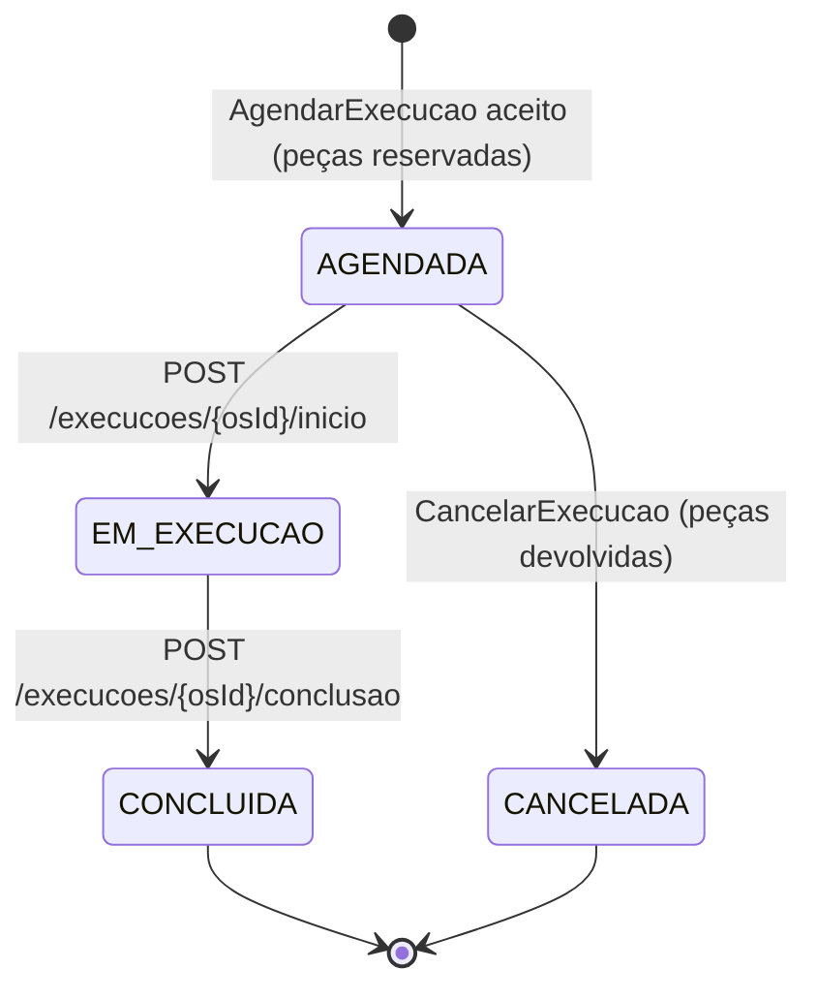
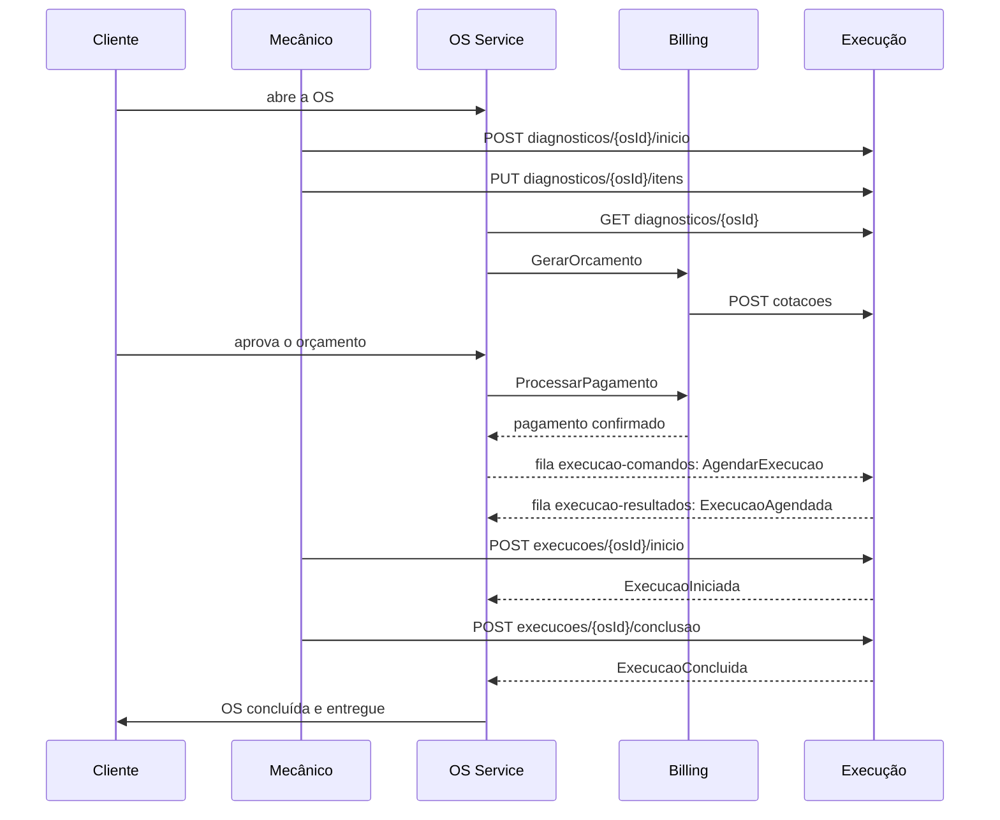

# Fluxo de negócio: da abertura da OS à conclusão

Este documento explica o **negócio** por trás do Execução Service: quem faz o quê em cada etapa de uma Ordem de Serviço, qual endpoint ou mensagem muda cada status e o que acontece quando algo dá errado. Para os campos exatos das mensagens, veja o [guia de integração](contrato-provisorio-saga.md); para a parte técnica, veja [funcionamento-do-servico.md](funcionamento-do-servico.md).
> Fronteira importante: o Execução Service só conhece o **estado do diagnóstico** e o **estado da execução**. O estado da **OS** (aguardando aprovação, concluída, entregue...) pertence ao OS Service. Quando este documento cita o status da OS, é a visão do fluxo geral da Saga, e a decisão é do OS Service.

---

## 1. Quem é quem

| Ator | Papel no fluxo |
| --- | --- |
| **Cliente** | Abre a OS, aprova ou reprova o orçamento e paga. |
| **Mecânico / operador** | Faz o diagnóstico, escolhe peças e serviços e, depois, inicia e conclui o trabalho. Usa os endpoints HTTP do Execução. |
| **OS Service** | Dono da OS e **orquestrador da Saga**. Decide o status da OS, envia comandos ao Execução e ao Billing e reage aos resultados. |
| **Billing Service** | Gera o orçamento, congela os preços e cobra pelo Mercado Pago. Consulta preços no Execução. |
| **Execução Service** | Dono do **catálogo e estoque de peças**, do **diagnóstico** e da **fila de trabalho**. Reserva peças, controla o andamento da execução e avisa o resultado. |

---

## 2. Os estados que o Execução controla

### Diagnóstico

Tem um único estado, `EM_DIAGNOSTICO`, e uma **versão** numérica. A versão sobe a cada alteração da lista de itens e serve para que dois operadores não sobrescrevam um ao outro: quem altera precisa informar a versão que leu (`versaoEsperada`).

### Execução

Se o estoque é insuficiente, **nenhuma execução é criada** (não existe um estado "rejeitada"): só sai o evento `ExecucaoRejeitada`.

---

## 3. Linha do tempo de uma OS (cenário feliz)

| # | O que acontece | Quem age | Endpoint ou mensagem | Efeito no Execução | Evento publicado |
| --- | --- | --- | --- | --- | --- |
| 1 | OS é aberta. Não dispara orçamento. | Cliente / OS Service | (nada no Execução) | nenhum | — |
| 2 | Mecânico começa o diagnóstico. | Mecânico | `POST /api/v1/diagnosticos/{osId}/inicio` | Diagnóstico criado: `EM_DIAGNOSTICO`, versão `1`, sem itens | — |
| 3 | Mecânico registra serviços e peças. | Mecânico | `PUT /api/v1/diagnosticos/{osId}/itens` | Lista de itens substituída; versão sobe (`1 → 2`...) | — |
| 4 | Alguém pede o orçamento. O OS lê os itens e aciona o Billing. | OS Service | `GET /api/v1/diagnosticos/{osId}` | nenhum (só leitura) | — |
| 5 | Billing monta o orçamento e congela os preços. | Billing | `POST /api/v1/cotacoes` | nenhum (só leitura; não reserva estoque) | — |
| 6 | Cliente aprova o orçamento e o pagamento é confirmado (Mercado Pago). | Cliente / Billing / OS | (nada no Execução) | nenhum | — |
| 7 | OS manda executar. | OS Service | Fila `execucao-comandos`: `AgendarExecucao` | Peças baixadas do estoque, execução criada em **`AGENDADA`** | `ExecucaoAgendada` |
| 8 | Mecânico começa o trabalho. | Mecânico | `POST /api/v1/execucoes/{osId}/inicio` | `AGENDADA → EM_EXECUCAO` (registra `iniciadaEm`) | `ExecucaoIniciada` |
| 9 | Mecânico termina o trabalho. | Mecânico | `POST /api/v1/execucoes/{osId}/conclusao` | `EM_EXECUCAO → CONCLUIDA` (registra `concluidaEm`) | `ExecucaoConcluida` |
| 10 | OS conclui e depois entrega o veículo. | OS Service | (nada no Execução) | nenhum | — |

Observações sobre o fluxo:

- O **Execução não avisa o OS do diagnóstico**: não há evento nem mensagem quando o mecânico inicia ou altera o diagnóstico. O OS só vê os itens quando consulta o `GET`. Se o OS precisar mostrar `EM_DIAGNOSTICO`, ele terá que deduzir isso por conta própria (ponto em aberto com o Gabriel Souza).
- O preço **não** fica no diagnóstico. O diagnóstico guarda só `itemId` e `quantidade`; o preço é lido na cotação e congelado pelo Billing no orçamento. Se o mecânico muda os itens depois do orçamento, a `versao` do diagnóstico muda e o orçamento fica desatualizado (é preciso gerar outro).
- Início e conclusão acontecem por HTTP, **não** por comando do OS. O OS fica sabendo pelos eventos.

---

## 4. Tabela "o que muda o status"

| Gatilho | Estado antes | Estado depois | Estoque | Evento publicado |
| --- | --- | --- | --- | --- |
| `POST /catalogo/PECA/{itemId}/estoque/reposicao` | Estoque *n* | Estoque *n + quantidade* | **Aumenta** | — |
| `PUT /catalogo/PECA/{itemId}/estoque` | Estoque *n* | Estoque definido | Sobrescreve | — |
| `DELETE /catalogo/{tipo}/{itemId}` ou `PUT` com `ativo: false` | Item ativo | Item inativo (recusado em diagnóstico, cotação e agendamento) | Sem alteração | — |
| `POST /diagnosticos/{osId}/inicio` | (inexistente) | Diagnóstico `EM_DIAGNOSTICO` v1 | — | — |
| `POST /diagnosticos/{osId}/inicio` de novo | Diagnóstico existente | Mesmo diagnóstico, sem mudança | — | — |
| `PUT /diagnosticos/{osId}/itens` | v *n* | v *n+1* | — | — |
| `AgendarExecucao` (estoque ok) | (inexistente) | Execução `AGENDADA` | Peças **baixadas** | `ExecucaoAgendada` |
| `AgendarExecucao` (saldo insuficiente) | (inexistente) | (continua inexistente) | Sem alteração | `ExecucaoRejeitada` |
| `POST /execucoes/{osId}/inicio` | `AGENDADA` | `EM_EXECUCAO` | — | `ExecucaoIniciada` |
| `POST /execucoes/{osId}/conclusao` | `EM_EXECUCAO` | `CONCLUIDA` | — | `ExecucaoConcluida` |
| `CancelarExecucao` | `AGENDADA` | `CANCELADA` | Peças **devolvidas** | `ExecucaoCancelada` |
| `CancelarExecucao` | `EM_EXECUCAO` ou `CONCLUIDA` | sem mudança | Sem alteração | `CancelamentoExecucaoRecusado` |
| `CancelarExecucao` | `CANCELADA` | sem mudança | Sem devolução repetida | `ExecucaoCancelada` |

Só **peças** mexem em estoque. Itens do tipo `SERVICO` ficam registrados na execução, mas nunca são baixados nem conferidos no momento do agendamento.

---

## 5. Cenários

Cada cenário abaixo foi exercitado manualmente no ambiente local (resultados na seção 7).

### Cenário A. Feliz: da OS à conclusão
É a tabela da seção 3. Estoque cai quando a execução é agendada e não volta.

### Cenário B. Estoque insuficiente
1. OS envia `AgendarExecucao` pedindo mais peças do que o saldo.
2. Nada é reservado e nenhuma execução é criada.
3. O Execução publica `ExecucaoRejeitada` (`motivo: ESTOQUE_INSUFICIENTE`, com o `itemId` da peça).
4. **O OS compensa:** cancela o orçamento e estorna o pagamento (via Billing), marcando a OS com falha.

Reenviar o mesmo `operationId` devolve a mesma rejeição. Para tentar de novo depois de repor estoque, o OS usa um `operationId` novo.

### Cenário C. Cancelamento antes de começar
1. OS envia `CancelarExecucao` com a execução em `AGENDADA`.
2. O Execução devolve as peças, muda para `CANCELADA` e publica `ExecucaoCancelada`.
3. O OS segue com o estorno e o encerramento da OS.

### Cenário D. Cancelamento recusado
1. OS envia `CancelarExecucao` com a execução em `EM_EXECUCAO` ou `CONCLUIDA`.
2. O Execução **não** cancela nem devolve peças (o trabalho já começou) e publica `CancelamentoExecucaoRecusado`.
3. O OS precisa tratar como falha de compensação.

### Cenário E. Reenvio de comando (duplicata)
O SQS pode entregar a mesma mensagem duas vezes, e o OS pode reenviar por não ter recebido a resposta. Com o **mesmo `operationId`**, o Execução reconhece a operação e não baixa estoque nem cria execução de novo. Do lado do OS, os eventos também podem chegar duplicados: ele deduplica por `messageId`.

### Cenário F. Mensagem que não consegue ser processada
Mensagens inválidas ou incoerentes **não geram evento**. Voltam para a fila e, após 5 recebimentos sem sucesso, vão para `execucao-comandos-dlq`, onde ficam até alguém investigar. Quando o erro é permanente (mensagem malformada, dados incoerentes), a mensagem é reentregue sem espera e chega à DLQ em segundos; quando pode ser transitório (por exemplo, a peça está inativa ou a execução ainda não existe), espera o tempo de visibilidade da fila entre as tentativas. Exemplos: JSON sem campo obrigatório, `type` desconhecido, peça inexistente ou inativa no catálogo, execução já existente para a OS com outro `operationId`, cancelamento de execução inexistente ou com `sagaId` diferente.

### Cenário G. Ações HTTP fora de ordem ou conflitantes
| Ação | Resultado |
| --- | --- |
| Iniciar ou concluir execução inexistente | `404` |
| Iniciar execução que não está `AGENDADA` (e não está `EM_EXECUCAO`) | `409` |
| Concluir execução que não está `EM_EXECUCAO` (e não está `CONCLUIDA`) | `409` |
| Repetir `inicio` em execução já `EM_EXECUCAO`, ou `conclusao` em já `CONCLUIDA` | `200`, devolve o registro atual, sem novo evento |
| `PUT` de itens com versão desatualizada | `409` |
| `PUT` de itens em diagnóstico que não foi iniciado | `404` |
| `PUT` ou cotação com item inexistente ou inativo | `400` |
| Cadastrar item de catálogo que já existe | `409` |
| Consultar, atualizar, inativar (`DELETE`) ou repor estoque de item inexistente | `404` |
| Repor estoque com quantidade fora de 1 a 1.000.000, ou repor/ajustar estoque de serviço | `400` |

---

## 6. Quem decide o quê

| Decisão | Quem decide |
| --- | --- |
| Status da OS (aguardando aprovação, concluída, entregue, falha) | OS Service |
| Quando disparar compensação e estorno, e em que ordem | OS Service (orquestrador) |
| Valor do orçamento e pagamento | Billing |
| Congelar o preço no orçamento | Billing (usa a cotação do Execução) |
| Se há peça suficiente para executar | Execução |
| Andamento do trabalho (`AGENDADA → EM_EXECUCAO → CONCLUIDA`) | Execução (a partir das ações do mecânico) |
| Se um cancelamento ainda é possível | Execução (só antes de iniciar) |
| `sagaId` | OS Service; o Execução apenas guarda e devolve |

---

## 7. Resultado da verificação manual

Os cenários acima foram executados em 02/11/2026 em ambiente local (DynamoDB Local e ElasticMQ, com o consumidor e o publicador ligados). O ElasticMQ emula o SQS, então tempos e ordem podem diferir um pouco na AWS. Estoque inicial: `filtro-oleo` = 10, `pastilha` = 2.

| Cenário | O que foi feito | Resultado observado |
| --- | --- | --- |
| Catálogo | Cadastro de peças e serviço; item duplicado; serviço com estoque | `204`; duplicado `409`; serviço com estoque `400` |
| Diagnóstico | GET e PUT sem iniciar; iniciar duas vezes; PUT com versão correta e desatualizada; item inexistente, inativo e repetido | `404`; `200` com a mesma v1; `200` v2; `409`; `400` nos três |
| Cotação | Itens válidos; item ausente; lista vazia | `200` com preços; `400`; `400` |
| A. Feliz (OS 201) | Agendar, iniciar, concluir | `AGENDADA` (estoque 10 → 8), depois `EM_EXECUCAO` e `CONCLUIDA`; eventos `ExecucaoAgendada`, `ExecucaoIniciada`, `ExecucaoConcluida` |
| E. Reenvio | Mesmo comando de agendamento reenviado; `inicio` e `conclusao` repetidos | Estoque continua 8; nenhum evento novo; `200` com o registro atual |
| G. Ordem inválida | Concluir antes de iniciar; iniciar após concluída ou cancelada; execução inexistente | `409`; `409`; `404` |
| B. Estoque insuficiente (OS 203) | Pedir 5 `pastilha` com saldo 2 | `ExecucaoRejeitada` (`ESTOQUE_INSUFICIENTE`, `pastilha`); estoque 2; sem execução (`404`) |
| B. Reenvio e nova tentativa | Mesma `operationId`; depois `operationId` novo com 1 unidade | Sem evento novo na primeira; a segunda gera `ExecucaoAgendada` e o estoque vai a 1 |
| C. Cancelar agendada (OS 204) | Reservar 3 `filtro-oleo` e cancelar | Estoque 8 → 5 → 8; `ExecucaoCancelada`; status `CANCELADA` |
| C. Cancelamento repetido | Mesma `operationId`; outra `operationId` | Mesma: nenhum evento novo. Outra: novo `ExecucaoCancelada`; estoque continua 8 |
| D. Cancelamento recusado | Cancelar OS concluída (201) e OS em execução (205) | `CancelamentoExecucaoRecusado` (`ESTADO_NAO_PERMITE_CANCELAMENTO`) nos dois; estoque sem devolução |
| F. Fila de comandos inválidos | 10 mensagens: `type` desconhecido, texto que não é JSON, peça inativa, peça inexistente, OS já com execução, cancelar OS inexistente, `sagaId` errado, `operationId` reaproveitado com dados diferentes, `schemaVersion` 2, `tipo` de item inválido | **As 10 chegaram à `execucao-comandos-dlq`** em cerca de 2 min 45 s; nenhum evento foi publicado; o estoque não mudou |

Pontos que o teste revelou:

- **Ordem dos eventos:** na leitura da fila os eventos não saem na ordem em que foram gerados (por exemplo, `ExecucaoConcluida` apareceu depois de `ExecucaoIniciada`, em leituras separadas, e `CancelamentoExecucaoRecusado` antes de `ExecucaoIniciada`). Confirma que o OS não pode depender de ordem.
- **O diagnóstico não é travado após o agendamento:** com a OS 201 já concluída, o `PUT` de itens ainda retornou `200` (versão 3). Isso não altera a execução já criada, mas faz o diagnóstico divergir do orçamento aprovado. É uma decisão de negócio a discutir: bloquear a edição após o agendamento, ou aceitar e deixar o OS detectar pela `versao`.
- **Execução inexistente no cancelamento** termina na DLQ, sem resposta ao OS. Continua como ponto em aberto com o Gabriel Souza.
