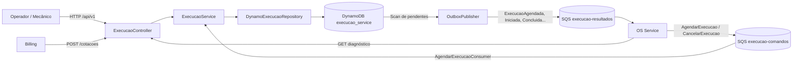
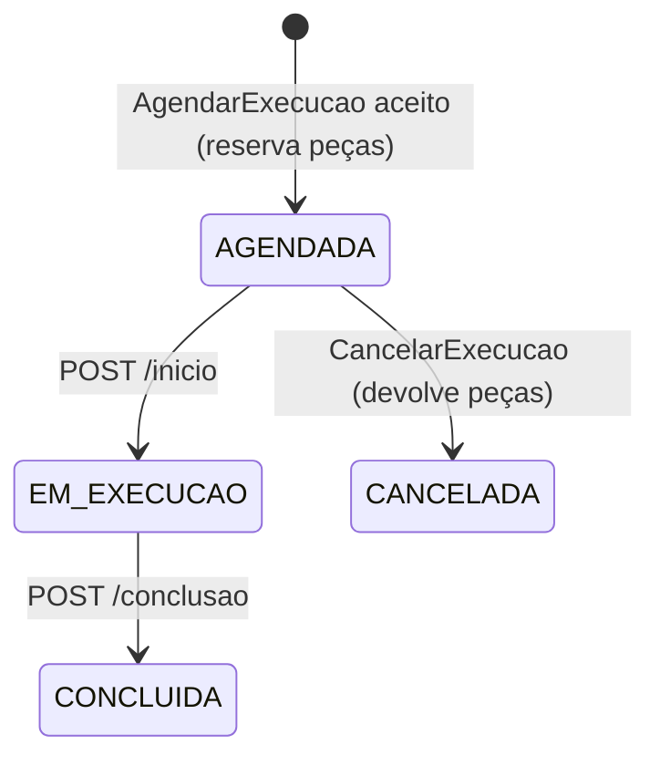

# Como o Execução Service funciona

Guia de leitura do código: o que o serviço faz, como recebe e publica mensagens, quais endpoints expõe e como tudo é persistido. Foi escrito a partir da implementação atual (branch `main`). Para os contratos detalhados de cada mensagem, veja [contrato-provisorio-saga.md](contrato-provisorio-saga.md); para o desenho de arquitetura e DLQs, veja [arquitetura-execucao.md](arquitetura-execucao.md).

## 1. Visão geral

O Execução Service é o microsserviço de **diagnóstico, catálogo/estoque e execução do trabalho** da Oficina FIAP (Tech Challenge Fase 4). Ele:

- guarda o **catálogo** de serviços e peças (preço e estoque);
- registra o **diagnóstico** da OS (lista de itens com versão);
- responde **cotações** de preço para o Billing;
- recebe, via SQS, os comandos `AgendarExecucao` e `CancelarExecucao` do OS Service;
- mantém a **fila de trabalho** (execuções `AGENDADA → EM_EXECUCAO → CONCLUIDA`, ou `CANCELADA`);
- publica o resultado de cada operação no SQS (`execucao-resultados`) usando o padrão **Transactional Outbox**.

Ele **não altera o banco nem o status da OS**; só informa o que aconteceu com a execução. Quem decide o estado da OS é o OS Service.



## 2. Stack e estrutura do código

Java 21, Spring Boot 4.0.5, AWS SDK v2 (DynamoDB e SQS), Maven, JaCoCo. O Swagger vem do springdoc-openapi 3.x (compatível com o Spring Boot 4); o pom também declara Lombok e Validation, que o código atual não utiliza (ver [seção 11](#11-lacunas-e-pontos-de-atenção)). O Resilience4j foi removido, porque o serviço não faz chamadas síncronas a outros serviços.

Arquitetura em camadas, estilo hexagonal (`br.com.fiap.soat15.execucaoservice`):

| Pacote | O que tem |
| --- | --- |
| `adapter/in/web` | `ExecucaoController` (rotas HTTP) e `ExecucaoExceptionHandler` (erros → `ProblemDetail`). |
| `adapter/in/sqs` | `AgendarExecucaoConsumer`: lê `execucao-comandos` e chama o service. |
| `application` | `ExecucaoService` (casos de uso e validações), interfaces `ExecucaoRepository` e `OutboxRepository`, `OutboxEvent` (monta a mensagem de saída) e exceções de negócio. |
| `domain/model` | Records: `ExecucaoTrabalho`, `Diagnostico`, `ItemCatalogo`, `ItemSolicitado`, `ItemCotado`, `Cotacao`, `AgendamentoExecucao`, enum `TipoItem` (`PECA`, `SERVICO`). |
| `contract` | `AgendarExecucaoCommand` e `CancelarExecucaoCommand`, com validação do envelope no construtor. |
| `adapter/out/dynamodb` | `DynamoExecucaoRepository` (fachada que implementa `ExecucaoRepository`) delega para `DynamoAgendamentoRepository` (agendar), `DynamoCicloExecucaoRepository` (iniciar, concluir, cancelar), `DynamoDiagnosticoRepository` e `DynamoCatalogoRepository`; `DynamoKeys` monta as chaves `pk`/`sk`. `DynamoOutboxRepository` cuida da leitura, reserva e baixa da outbox. |
| `adapter/out/sqs` | `OutboxPublisher`: envia eventos pendentes para `execucao-resultados`. |
| `config` | Clientes `DynamoDbClient` e `SqsClient`, `Clock` UTC e `@EnableScheduling`. |

## 3. Endpoints HTTP

Todas as rotas ficam sob `/api/v1`. **Nenhuma exige autenticação hoje.** Erros usam `ProblemDetail` (RFC 7807): `400` dados inválidos, `404` não encontrado, `409` conflito de estado/versão/duplicidade.

### Catálogo e estoque

| Método e rota | Função | Respostas |
| --- | --- | --- |
| `POST /api/v1/catalogo` | Cadastra peça ou serviço. | `204`; `409` item já existe; `400` inválido |
| `GET /api/v1/catalogo?tipo=&ativo=&nome=` | Lista itens; filtros opcionais por `tipo` (`PECA`/`SERVICO`), `ativo` (`true`/`false`) e `nome` (contém, sem diferenciar acento nem maiúsculas). Ordenado por tipo e `itemId`. | `200`; `400` filtro inválido |
| `GET /api/v1/catalogo/{tipo}/{itemId}` | Consulta um item, com o estoque atual da peça. | `200`; `404`; `400` tipo inválido |
| `PUT /api/v1/catalogo/{tipo}/{itemId}` | Atualiza `nome`, `descricao`, `precoUnitario`, `ativo` e (serviço) `tempoEstimadoMinutos`. Substitui os dados: `descricao` e `tempoEstimadoMinutos` ausentes são removidos. **Não** altera o estoque. | `200`; `404`; `400` |
| `DELETE /api/v1/catalogo/{tipo}/{itemId}` | Soft delete: marca o item como inativo, sem apagar cadastro nem estoque. Repetir retorna `204`. Para reativar, `PUT` com `ativo: true`. | `204`; `404` |
| `POST /api/v1/catalogo/PECA/{itemId}/estoque/reposicao` | **Soma** `quantidade` (1 a 1.000.000) ao estoque, de forma atômica. | `200`; `404`; `400` |
| `PUT /api/v1/catalogo/PECA/{itemId}/estoque` | **Define** o estoque (`quantidadeEstoque`, 0 a 1.000.000), por exemplo após contagem física. | `200`; `404`; `400` |

Todas as rotas que alteram devolvem o item atualizado. Serviços não têm estoque: reposição ou ajuste em `SERVICO` retorna `400`. Corpos de exemplo:

```json
{"nome":"Troca de óleo","descricao":"Inclui filtro","precoUnitario":95.00,"ativo":true,"tempoEstimadoMinutos":45}
```

```json
{"quantidade":5}
```

```json
{"quantidadeEstoque":10}
```

Cuidados:

- Inativar um item faz o diagnóstico e a cotação o recusarem (`400`) e **faz o comando `AgendarExecucao` que o contém falhar** (a mensagem vai para a DLQ, sem evento ao OS). Evite inativar peças que tenham orçamento aprovado aguardando agendamento.
- O ajuste absoluto sobrescreve o valor e pode apagar uma reserva feita ao mesmo tempo. Prefira a reposição para entradas de estoque.

Cadastro (`POST`): corpo de exemplo:

```json
{"tipo":"PECA","itemId":"filtro-oleo","nome":"Filtro de óleo","descricao":"Filtro original","precoUnitario":45.50,"ativo":true,"quantidadeEstoque":10}
```

`descricao` (até 300 caracteres) é opcional em qualquer item; `tempoEstimadoMinutos` (inteiro maior que zero) é opcional e só vale para `SERVICO`. As respostas trazem os dois campos (`null` quando ausentes).

Regras do cadastro: `PECA` exige `quantidadeEstoque` inteira ≥ 0; `SERVICO` exige que seja nula. Preço ≥ 0 com no máximo 2 casas (vale também para a atualização).

### Diagnóstico

| Método e rota | Função | Respostas |
| --- | --- | --- |
| `POST /api/v1/diagnosticos/{osId}/inicio` | Inicia o diagnóstico (versão `1`, sem itens) ou devolve o existente. Sem corpo. | `200` |
| `PUT /api/v1/diagnosticos/{osId}/itens` | **Substitui** a lista de itens com controle otimista de versão. | `200`; `404`; `409` versão desatualizada; `400` |
| `GET /api/v1/diagnosticos/{osId}` | Consulta itens e versão atuais (usado pelo OS Service). | `200`; `404` |

Corpo do `PUT`:

```json
{"versaoEsperada":1,"itens":[{"tipo":"SERVICO","itemId":"troca-oleo","quantidade":1},{"tipo":"PECA","itemId":"filtro-oleo","quantidade":1}]}
```

Regras: de 1 a 20 itens, sem repetir `tipo/itemId`, quantidade positiva e `versaoEsperada > 0`. Antes de gravar, o service chama `cotar()` para garantir que todos os itens existem e estão **ativos** no catálogo. O diagnóstico guarda só ID e quantidade, nunca preço.

### Cotação

| Método e rota | Função | Respostas |
| --- | --- | --- |
| `POST /api/v1/cotacoes` | Devolve os preços atuais dos itens (moeda `BRL`). Não cria orçamento nem reserva estoque. | `200`; `400` item ausente/inativo |

Corpo: `{"itens":[{"tipo":"PECA","itemId":"filtro-oleo","quantidade":2}]}`. O Billing usa isso para congelar os preços no orçamento.

### Fila de trabalho (execuções)

| Método e rota | Função | Respostas |
| --- | --- | --- |
| `GET /api/v1/execucoes?limite=&pagina=` | Lista as execuções. Sem `limite`, devolve todas (Scan). Com `limite` (1 a 100), devolve uma página e informa o token da próxima no cabeçalho `X-Proxima-Pagina` (ausente na última página); esse token é enviado como `pagina` na chamada seguinte. O token é opaco: não é um número e não se monta à mão. O corpo continua sendo a lista. | `200`; `400` limite ou pagina inválidos |
| `GET /api/v1/execucoes/{osId}` | Consulta uma execução. | `200`; `404` |
| `POST /api/v1/execucoes/{osId}/inicio` | `AGENDADA → EM_EXECUCAO`. Idempotente se já estiver em execução. | `200`; `404`; `409` |
| `POST /api/v1/execucoes/{osId}/conclusao` | `EM_EXECUCAO → CONCLUIDA`. Idempotente se já concluída. | `200`; `404`; `409` |

Não existe rota HTTP para criar ou cancelar execução: isso só acontece por mensagem SQS.

### Outros

- `GET /actuator/health` e `GET /actuator/info` (únicos endpoints do Actuator expostos; `show-details: always`).
- O Kubernetes usa `/actuator/health/readiness` e `/actuator/health/liveness` nas probes.

## 4. Como o serviço **consome** mensagens (SQS)

Classe: `AgendarExecucaoConsumer`. Só é criada se `SQS_CONSUMER_ENABLED=true`; nesse caso `SQS_EXECUCAO_COMANDOS_URL` é obrigatória, senão a aplicação não sobe.

1. A cada `SQS_CONSUMER_POLL_DELAY_MS` (padrão 5 s) faz `receiveMessage` com até `SQS_CONSUMER_MAX_MESSAGES` mensagens (padrão e máximo 10) e long polling de 10 s. As mensagens do lote são processadas em sequência e a falha de uma não impede as demais.
2. Lê o campo `type` do JSON:
   - `AgendarExecucao` → desserializa em `AgendarExecucaoCommand` → `ExecucaoService.agendarExecucao`.
   - `CancelarExecucao` → desserializa em `CancelarExecucaoCommand` → `ExecucaoService.cancelarExecucao`.
   - qualquer outro → `IllegalArgumentException`.
3. Se o processamento termina sem exceção, **apaga a mensagem** da fila.
4. Se lança `RuntimeException`, **não apaga** a mensagem, e o SQS a reentrega e, após `maxReceiveCount` (3) recebimentos, move para `execucao-comandos-dlq`. O consumidor distingue dois tipos de falha:
   - **Permanente** (JSON inválido, envelope que não passa na validação, `type` desconhecido, `operationId` reutilizado com dados diferentes, `sagaId` divergente, OS que já tem execução): nunca vai funcionar em nova tentativa. Registra `ERROR` e libera a mensagem na hora (`ChangeMessageVisibility` com 0), então ela chega à DLQ em segundos em vez de minutos.
   - **Transitória** (banco indisponível, peça inativa ou ausente, execução ainda inexistente no cancelamento): registra `WARN` com o erro e espera o tempo de visibilidade da fila (60 s no Terraform), porque uma nova tentativa pode dar certo.
5. Exceção: `PecaIndisponivelException` no agendamento é tratada como resultado de negócio. O consumidor loga e apaga a mensagem, porque a rejeição já foi gravada na outbox.

### Envelope dos comandos (validado no construtor do record)

`schemaVersion` deve ser `1`; `messageId` deve ser UUID válido; `operationId`, `sagaId`, `osId` e `occurredAt` (ISO-8601) são obrigatórios; `type` precisa bater com o comando. `causationId` é opcional.

`AgendarExecucao` traz ainda `payload` com `orcamentoId`, `versao` (> 0), `pagamentoId` e `itens` (1 a 20). `CancelarExecucao` não tem payload.

### O que acontece em cada comando

**`AgendarExecucao`** (`agendarExecucao` → `DynamoExecucaoRepository.agendarExecucao`):

- Uma única `TransactWriteItems` faz tudo ou nada:
  1. baixa o estoque de cada **peça** (condição: ativa e `quantidadeEstoque >= quantidade`);
  2. cria a execução `OS#{osId} / EXECUCAO` com status `AGENDADA` (condição: ainda não existe);
  3. grava a operação `OPERACAO#{operationId} / AGENDAMENTO` (deduplicação);
  4. grava o evento `ExecucaoAgendada` na outbox.
- **Idempotência:** se a `operationId` já existe, devolve o agendamento anterior sem mexer no estoque. Reusar a mesma `operationId` com dados diferentes é erro.
- **Estoque insuficiente:** a transação é cancelada e o serviço grava a operação com resultado `REJEITADA` junto com o evento `ExecucaoRejeitada` (`motivo: ESTOQUE_INSUFICIENTE`, `itemId`).
- Peça ausente ou inativa lança `PecaIndisponivelException`.
- Segunda operação para uma OS que já tem execução lança `ExecucaoJaAgendadaException`.
- Itens do tipo `SERVICO` ficam registrados na execução, mas não mexem em estoque.

**`CancelarExecucao`** (`cancelarExecucao`):

- Execução inexistente → `NoSuchElementException`: a mensagem não é apagada, vai para nova tentativa e depois DLQ.
- `sagaId` diferente do da execução → `IllegalArgumentException` (mesmo efeito).
- Status `AGENDADA` → transação que **devolve o estoque das peças**, muda o status para `CANCELADA`, registra a operação e grava `ExecucaoCancelada` na outbox.
- Status `CANCELADA` → confirma de novo (`ExecucaoCancelada`) sem devolver estoque outra vez.
- Status `EM_EXECUCAO` ou `CONCLUIDA` → grava `CancelamentoExecucaoRecusado` (`motivo: ESTADO_NAO_PERMITE_CANCELAMENTO`), sem devolver peças.
- Repetir a mesma `operationId` não gera nova devolução nem novo evento.

## 5. Como o serviço **publica** mensagens (Transactional Outbox)

O serviço **nunca chama o SQS dentro da regra de negócio**. Cada mudança de estado grava o evento no DynamoDB **na mesma transação** da mudança, e um processo separado entrega depois. Isso evita perder evento (ou publicar evento de algo que não foi salvo).

### Quem grava na outbox

| Origem | Evento gravado |
| --- | --- |
| Agendamento aceito | `ExecucaoAgendada` |
| Agendamento sem estoque | `ExecucaoRejeitada` |
| `POST .../inicio` | `ExecucaoIniciada` |
| `POST .../conclusao` | `ExecucaoConcluida` |
| Cancelamento aceito | `ExecucaoCancelada` |
| Cancelamento recusado | `CancelamentoExecucaoRecusado` |

Item da outbox: `pk = OUTBOX#{operationId}`, `sk = RESULTADO`, com `published = false`. Para início e conclusão a `operationId` é derivada da OS (`iniciar-execucao-<uuid-da-os>` e `concluir-execucao-<uuid-da-os>`), então o evento de cada ação é único por OS.

### `OutboxPublisher`

Só existe se `OUTBOX_PUBLISHER_ENABLED=true` (exige `SQS_EXECUCAO_RESULTADOS_URL`). A cada `OUTBOX_POLL_DELAY_MS` (padrão 5 s):

1. Busca até 20 eventos pendentes (`DynamoOutboxRepository.pendentes`, via `Scan` filtrado).
2. Para cada um, tenta **reservar** (lease de 2 minutos) com update condicional: só reserva se `published = false` e não há lease vigente. Isso impede que duas réplicas publiquem o mesmo evento.
3. Envia `sendMessage` para `execucao-resultados`.
4. Se o SQS devolve `messageId`, marca como publicado (`published = true`, remove o lease).
5. Se falha, loga e o evento volta a ser elegível quando o lease expira.

**Garantia:** *at-least-once*. Se o SQS aceitar a mensagem e a marcação no DynamoDB falhar, o evento pode sair duas vezes. O consumidor (OS Service) deve deduplicar por `messageId`/`operationId` e tolerar eventos fora de ordem.

### Formato da mensagem publicada

`OutboxEvent.mensagem()` monta o envelope:

```json
{
  "schemaVersion": 1,
  "messageId": "<UUID determinístico de type + operationId>",
  "operationId": "agendar-os-123-orcamento-v2",
  "type": "ExecucaoAgendada",
  "sagaId": "saga-123",
  "osId": "123",
  "causationId": "<messageId do comando recebido>",
  "occurredAt": "2026-11-02T14:00:00Z",
  "payload": {"status":"AGENDADA","orcamentoId":"orc-123","versao":2,"pagamentoId":"pag-123"}
}
```

Payload por tipo:

| `type` | `payload` |
| --- | --- |
| `ExecucaoAgendada` | `status: AGENDADA`, `orcamentoId`, `versao`, `pagamentoId` |
| `ExecucaoRejeitada` | `orcamentoId`, `versao`, `pagamentoId`, `motivo`, `itemId` |
| `ExecucaoIniciada` | `status: EM_EXECUCAO`, `iniciadaEm` + ids do orçamento/pagamento |
| `ExecucaoConcluida` | `status: CONCLUIDA`, `iniciadaEm`, `concluidaEm` + ids |
| `ExecucaoCancelada` | `status: CANCELADA` + ids |
| `CancelamentoExecucaoRecusado` | `motivo` + ids |

Como o `messageId` é derivado de `type + operationId`, reenviar o mesmo evento mantém o mesmo `messageId`, o que facilita a deduplicação no consumidor.

## 6. Máquina de estados da execução



Estoque insuficiente não cria execução. Chamar `/inicio` ou `/conclusao` fora do estado esperado retorna `409`; repetir a ação já feita devolve o registro atual (idempotente). Os updates usam condição no status (`#status = :esperado`), então duas chamadas concorrentes não corrompem o estado.

O diagnóstico tem um único estado, `EM_DIAGNOSTICO`, e uma versão numérica incrementada a cada `PUT`.

## 7. Modelo de dados (DynamoDB, single table)

Tabela `execucao_service`, chaves `pk` e `sk` (string), cobrança `PAY_PER_REQUEST`, sem índices secundários.

| Dado | `pk` | `sk` |
| --- | --- | --- |
| Diagnóstico | `OS#{osId}` | `DIAGNOSTICO` |
| Execução | `OS#{osId}` | `EXECUCAO` |
| Peça / serviço do catálogo | `PECA#{itemId}` ou `SERVICO#{itemId}` | `CADASTRO` |
| Operação de agendamento | `OPERACAO#{operationId}` | `AGENDAMENTO` |
| Operação de cancelamento | `OPERACAO#{operationId}` | `CANCELAMENTO` |
| Evento de outbox | `OUTBOX#{operationId}` | `RESULTADO` |

`GET /execucoes` e a busca de pendentes da outbox usam `Scan` (filtrando por `pk` com prefixo `OS#`/`sk = EXECUCAO` e `published = false`, respectivamente). A listagem de execuções aceita paginação (o token `pagina` é a chave `pk`/`sk` do último item, em Base64 URL). O Scan percorre a tabela inteira a cada chamada, então o custo cresce com o volume.

**Avaliação de índice (decisão: não implementar agora).** A tabela do Pedro não tem índice secundário, e criar um exige alterar a tabela e todos os pontos que gravam. Se o volume crescer, o desenho recomendado são dois índices esparsos: (1) um para a outbox pendente (atributo `gsi1pk = OUTBOX#PENDENTE`, removido ao publicar), que troca o `Scan` do publicador, executado a cada 5 s, por um `Query`; e (2) um por status da execução (`gsi2pk = EXECUCAO#<status>`, `gsi2sk = agendadaEm`), para listar a fila de trabalho já filtrada e ordenada. O primeiro é o mais importante, porque roda continuamente.

## 8. Contrato de integração entre os serviços

| Fila | Quem publica | Quem consome | DLQ |
| --- | --- | --- | --- |
| `execucao-comandos` | OS Service | **Execução** | `execucao-comandos-dlq` |
| `execucao-resultados` | **Execução** | OS Service | `execucao-resultados-dlq` |
| `billing-comandos` / `billing-resultados` | OS / Billing | Billing / OS | (fora deste repositório) |

Fluxo típico de uma OS:

1. OS Service abre a OS (sem orçamento).
2. Mecânico: `POST /diagnosticos/{osId}/inicio` e `PUT .../itens` no Execução.
3. OS Service lê `GET /diagnosticos/{osId}`, aciona o Billing; o Billing chama `POST /cotacoes` para fixar os preços.
4. Após orçamento aprovado e pagamento confirmado, o OS envia `AgendarExecucao` → Execução reserva peças e publica `ExecucaoAgendada` (ou `ExecucaoRejeitada`).
5. Mecânico: `POST /execucoes/{osId}/inicio` → `ExecucaoIniciada`; depois `POST /execucoes/{osId}/conclusao` → `ExecucaoConcluida`.
6. Se o cliente desistir antes do início, o OS envia `CancelarExecucao` → `ExecucaoCancelada` (peças devolvidas) ou `CancelamentoExecucaoRecusado`.

Compensação (saga): o `ExecucaoRejeitada` e o `ExecucaoCancelada` são os sinais que o OS Service usa para disparar estorno/compensação. A ordem entre cancelamento e estorno e a regra para cancelar execução inexistente ainda estão **em aberto** com o grupo.

## 9. Configuração

Arquivo `src/main/resources/application.yaml`, tudo por variável de ambiente:

| Variável | Padrão | Função |
| --- | --- | --- |
| `AWS_REGION` | `us-east-1` | Região dos clientes AWS |
| `DYNAMODB_TABLE_NAME` | `execucao_service` | Nome da tabela |
| `DYNAMODB_ENDPOINT_URL` | vazio | Endpoint local do DynamoDB (override) |
| `SQS_ENDPOINT_URL` | vazio | Endpoint local do SQS (override) |
| `SQS_EXECUCAO_COMANDOS_URL` | vazio | Fila que o serviço consome |
| `SQS_EXECUCAO_RESULTADOS_URL` | vazio | Fila onde publica resultados |
| `SQS_CONSUMER_ENABLED` | `false` | Liga o consumidor |
| `SQS_CONSUMER_POLL_DELAY_MS` | `5000` | Intervalo do consumidor |
| `SQS_CONSUMER_MAX_MESSAGES` | `10` | Mensagens lidas por vez (1 a 10) |
| `OUTBOX_PUBLISHER_ENABLED` | `false` | Liga o publicador |
| `OUTBOX_POLL_DELAY_MS` | `5000` | Intervalo do publicador |

Consumidor e publicador vêm **desligados por padrão**. Habilitar não cria filas nem tabela: os recursos precisam existir (Terraform em `terraform/`).

### Rodando localmente

```bash
./mvnw clean verify          # build + testes + JaCoCo
./mvnw spring-boot:run       # sobe na porta 8080
```

Para exercitar o fluxo completo, suba DynamoDB local e SQS local (ex.: ElasticMQ), crie a tabela (`pk`/`sk`) e as filas, e exporte os endpoints, as URLs das filas e as flags `SQS_CONSUMER_ENABLED=true` e `OUTBOX_PUBLISHER_ENABLED=true`. Credenciais AWS fictícias bastam localmente.

Exemplo de ponta a ponta apenas por HTTP (sem SQS):

```bash
curl -X POST localhost:8080/api/v1/catalogo -H 'Content-Type: application/json' \
  -d '{"tipo":"PECA","itemId":"filtro-oleo","nome":"Filtro de óleo","precoUnitario":45.50,"ativo":true,"quantidadeEstoque":10}'
curl -X POST localhost:8080/api/v1/diagnosticos/123/inicio
curl -X PUT  localhost:8080/api/v1/diagnosticos/123/itens -H 'Content-Type: application/json' \
  -d '{"versaoEsperada":1,"itens":[{"tipo":"PECA","itemId":"filtro-oleo","quantidade":1}]}'
curl -X POST localhost:8080/api/v1/cotacoes -H 'Content-Type: application/json' \
  -d '{"itens":[{"tipo":"PECA","itemId":"filtro-oleo","quantidade":1}]}'
```

Para criar a execução é preciso enviar um `AgendarExecucao` na fila `execucao-comandos` (veja o exemplo em [contrato-provisorio-saga.md](contrato-provisorio-saga.md)).

## 10. Infraestrutura, CI/CD e testes

- **Terraform** (`terraform/`): tabela `execucao_service` e as filas `execucao-comandos` e `execucao-resultados` com DLQs (retenção de 14 dias, visibilidade 60 s, long polling 10 s, `sqs_max_receive_count = 3`). Os outputs expõem as URLs. Antes de aplicar, confirmar com o Pedro quem é dono do estado dessas filas.
- **CI** (`ci.yml`): `./mvnw clean verify` em push/PR para `main`. **Terraform** (`terraform-check.yml`): `fmt`, `init` e `validate` quando `terraform/**` muda.
- **CD** (`deploy.yml`): em push na `main`, builda a imagem (Dockerfile multi-stage Maven → JDK 21 Alpine), publica em `ghcr.io` e aplica no Kubernetes (`namespace oficina-ms`, 1 réplica, Service `ClusterIP` na porta 8080, probes de readiness/liveness no Actuator).
- **Testes** (`src/test`): consumer, repositórios DynamoDB e outbox, publisher, `ExecucaoService` e validação do contrato `AgendarExecucaoCommand`.

## 11. Lacunas e pontos de atenção

Itens que você citou como pendentes, mais o que a análise do código mostrou:

**Pendentes já conhecidos**

- **Métricas e observabilidade:** só existe `health` e `info` no Actuator. O `ConfigMap` do deploy já define variáveis `OTEL_*` (New Relic), mas o `pom.xml` não tem nenhum agente/starter OpenTelemetry nem Micrometer registry, então hoje elas não têm efeito. Também não há logs estruturados, nem correlação por `sagaId`/`osId` (os logs atuais são mensagens simples).
- **Proteção das rotas:** nenhuma rota tem autenticação ou autorização. Falta definir com o grupo como operador e serviços (OS, Billing) se autenticam e como isso se encaixa no Gateway.

**Observados no código**

- O deploy (`deploy.yml`) não define `SQS_*` nem `OUTBOX_*` no ConfigMap. Então, **como está, o pod sobe com consumidor e publicador desligados** e o serviço não processa nem publica nada via SQS. É preciso adicionar as URLs das filas e as flags.
- Validation e Lombok estão no `pom.xml` sem uso no código (os controllers não usam Bean Validation). Ou usa, ou tira do pom.
- `Scan` na outbox e na listagem de execuções sem `limite`, e na listagem do catálogo (sem paginação, ordenada em memória). A listagem de execuções já aceita paginação; o índice foi avaliado e fica para quando o volume crescer.
- A cobertura mínima de 80% e o quality gate são exigência do desafio e ainda não estão no CI (o JaCoCo só gera relatório). BDD também consta como pendente no README.
- Decisões em aberto com o grupo: quando a OS passa a `EM_EXECUCAO`, quem gera o `sagaId`, resposta para cancelamento de execução inexistente e ordem cancelamento/estorno.
