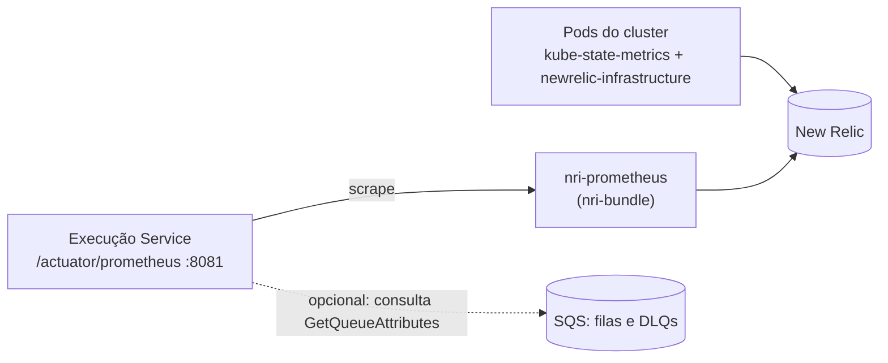

# Observabilidade do Execução Service

Este documento descreve as métricas que o serviço expõe, como elas chegam ao New Relic e como consultá-las. O desenho segue o do `oficina_fiap` (ADR-004 daquele projeto): Micrometer expõe as métricas em formato Prometheus numa porta de gerenciamento, e o `nri-bundle` do New Relic coleta os pods do cluster.

> Escopo atual: **métricas** (negócio, JVM, CPU, memória e limites do container). Traces distribuídos pelo SQS e logs JSON correlacionados ainda não foram implementados (ver [pendências](#o-que-ainda-não-está-feito)).

## Como funciona



| Origem | O que entrega | Quem fornece |
| --- | --- | --- |
| Micrometer no serviço | Métricas de negócio (`oficina_execucao_*`), HTTP, JVM, CPU do processo e limites lidos do cgroup (`oficina_container_*`) | Este repositório |
| `newrelic-infrastructure` e `kube-state-metrics` | CPU, memória, **requests e limits** dos pods, reinícios, réplicas | `nri-bundle` instalado no cluster |
| `nri-prometheus` | Coleta o `/actuator/prometheus` dos pods com a anotação do `k8s/metrics-service.yaml` | `nri-bundle` instalado no cluster |

### Porta de gerenciamento

O Actuator fica na porta **8081** (`MANAGEMENT_SERVER_PORT`), separada da API (8080), como no `oficina_fiap`. Assim as métricas não passam pelo Service principal nem pelo futuro Gateway.

| Endereço | Uso |
| --- | --- |
| `GET :8081/actuator/health` | Saúde geral |
| `GET :8081/actuator/health/liveness` e `/readiness` | Probes do Kubernetes |
| `GET :8081/actuator/prometheus` | Todas as métricas, formato Prometheus |
| `GET :8081/actuator/metrics` | Lista e consulta de métricas (formato Micrometer) |

No Kubernetes, o `k8s/metrics-service.yaml` cria o Service interno `execucao-service-metrics` com as anotações `prometheus.io/scrape`, `path` e `port`, que o `nri-prometheus` usa para descobrir o alvo. O `deployment.yaml` expõe a porta `management` e usa a 8081 nas probes.

## Catálogo de métricas

Nomes no formato Prometheus (como aparecem no endpoint). Todas recebem a etiqueta `application="execucao-service"`.

### Regras de negócio

| Métrica | Tipo | Etiquetas | O que mede |
| --- | --- | --- | --- |
| `oficina_execucao_agendamentos_total` | contador | `resultado`: `agendada`, `rejeitada` | Agendamentos aceitos e rejeitados por falta de estoque. Reenvios do mesmo comando não contam de novo; uma rejeição reenviada conta de novo |
| `oficina_execucao_pecas_reservadas_total` | contador | | Unidades de peças baixadas do estoque pelos agendamentos (serviços não contam) |
| `oficina_execucao_fila_espera_seconds` | histograma | | Tempo entre o agendamento e o início da execução |
| `oficina_execucao_duracao_seconds` | histograma | | Tempo entre o início e a conclusão da execução |
| `oficina_execucao_estoque_reposto_total` | contador | | Unidades repostas pela rota de reposição |
| `oficina_execucao_estoque_ajustes_total` | contador | | Ajustes absolutos de estoque |
| `oficina_execucao_eventos_publicados_total` | contador | `tipo`: `ExecucaoAgendada`, `ExecucaoRejeitada`, `ExecucaoIniciada`, `ExecucaoConcluida`, `ExecucaoCancelada`, `CancelamentoExecucaoRecusado` | Eventos entregues em `execucao-resultados`. É o melhor indicador de desfechos (inclusive cancelamentos aceitos e recusados) |
| `oficina_execucao_eventos_falhas_total` | contador | | Falhas ao publicar um evento (ele é tentado de novo depois do lease) |
| `oficina_execucao_outbox_atraso_seconds` | medidor | | Idade do evento pendente mais antigo da outbox. Perto de 0 é saudável; crescer indica que o publicador parou |

### Consumo de comandos (SQS)

| Métrica | Tipo | Etiquetas | O que mede |
| --- | --- | --- | --- |
| `oficina_execucao_comandos_processados_total` | contador | `tipo`: `AgendarExecucao`, `CancelarExecucao` | Comandos concluídos e confirmados (inclui agendamento rejeitado por estoque, que é um resultado de negócio) |
| `oficina_execucao_comandos_duracao_seconds` | histograma | `tipo` | Tempo de processamento de um comando |
| `oficina_execucao_comandos_falhas_total` | contador | `tipo` (ou `desconhecido`), `natureza`: `permanente`, `transitoria` | Falhas. `permanente` vai à DLQ em segundos; `transitoria` espera o tempo de visibilidade |
| `oficina_execucao_fila_mensagens` | medidor | `fila`: `comandos`, `comandos-dlq`, `resultados`, `resultados-dlq`; `estado`: `visiveis`, `em_processamento` | Mensagens nas filas. **Qualquer valor acima de zero em `*-dlq` pede investigação** |

`oficina_execucao_fila_mensagens` só existe com `SQS_METRICS_ENABLED=true` e precisa das URLs das filas (incluindo as DLQs: `SQS_EXECUCAO_COMANDOS_DLQ_URL` e `SQS_EXECUCAO_RESULTADOS_DLQ_URL`). Ele consulta o SQS a cada `SQS_METRICS_POLL_DELAY_MS` (60 s por padrão), então o valor tem esse atraso.

### Pod, CPU, memória e limites

| Métrica | Tipo | O que mede |
| --- | --- | --- |
| `oficina_container_memoria_limite_bytes` | medidor | Limite de memória do container (lido do cgroup). Só existe se houver limite |
| `oficina_container_memoria_uso_bytes` | medidor | Memória em uso pelo container |
| `oficina_container_cpu_limite_nucleos` | medidor | Limite de CPU em núcleos (por exemplo, `0.5` para `500m`). Só existe se houver limite |
| `process_cpu_usage`, `system_cpu_usage`, `system_cpu_count` | medidor | CPU do processo e do sistema (Micrometer) |
| `jvm_memory_used_bytes`, `jvm_memory_max_bytes`, `jvm_gc_*`, `jvm_threads_*` | medidor/contador | Memória, coleta de lixo e threads da JVM |
| `process_uptime_seconds` | medidor | Tempo desde o início do processo |
| `http_server_requests_seconds` | histograma | Requisições HTTP por rota, método e status (inclui erros `4xx`/`5xx`) |

Os medidores `oficina_container_*` leem `/sys/fs/cgroup` (cgroup v2, com fallback para o v1). Fora de um container, como no Mac em desenvolvimento, eles simplesmente não aparecem.

**Requests e limits do pod** (`256Mi`/`200m` e `512Mi`/`500m`, definidos em `k8s/deployment.yaml`) também chegam ao New Relic pela integração com o Kubernetes, e é essa a fonte para ver o uso **contra** o limite no tempo.

## Como ver as métricas

### Localmente

```bash
curl -s http://localhost:8081/actuator/prometheus | grep oficina_
```

Para ver as métricas de fila, suba a aplicação com `SQS_METRICS_ENABLED=true` e as quatro URLs de fila. Faça o fluxo (agendar, iniciar, concluir, cancelar) e consulte de novo: os contadores e histogramas aparecem depois da primeira ocorrência.

### No New Relic (sugestões)

As consultas abaixo são ponto de partida e **precisam ser conferidas na conta do grupo** (nomes e tipos dependem de como o `nri-prometheus` converte cada métrica).

Desfechos da execução por tipo, ao longo do tempo:

```sql
SELECT sum(oficina_execucao_eventos_publicados_total) FROM Metric
WHERE application = 'execucao-service' FACET tipo TIMESERIES
```

Rejeições por estoque contra agendamentos aceitos:

```sql
SELECT sum(oficina_execucao_agendamentos_total) FROM Metric
WHERE application = 'execucao-service' FACET resultado TIMESERIES
```

Mensagens em DLQ (para alerta quando maior que zero):

```sql
SELECT latest(oficina_execucao_fila_mensagens) FROM Metric
WHERE application = 'execucao-service' AND fila LIKE '%dlq' AND estado = 'visiveis' FACET fila
```

Atraso da outbox (alerta se passar de 60 s por alguns minutos):

```sql
SELECT max(oficina_execucao_outbox_atraso_seconds) FROM Metric
WHERE application = 'execucao-service' TIMESERIES
```

CPU, memória e limites dos pods (integração Kubernetes):

```sql
SELECT average(cpuUsedCores), max(cpuLimitCores), average(memoryWorkingSetBytes), max(memoryLimitBytes)
FROM K8sContainerSample WHERE containerName = 'execucao-service' FACET podName TIMESERIES
```

### Alertas sugeridos

| Condição | Motivo |
| --- | --- |
| `fila_mensagens{fila=~".*dlq", estado="visiveis"} > 0` | Há comandos ou resultados que não foram processados |
| `outbox_atraso_seconds > 60` por 5 min | O publicador está parado ou o SQS está indisponível |
| `comandos_falhas_total{natureza="permanente"}` em alta | Mensagens inválidas chegando do OS Service |
| Memória do container acima de 80% do limite | Risco de reinício por falta de memória |
| `agendamentos_total{resultado="rejeitada"}` em alta | Falta de estoque |

## Configuração

| Variável | Padrão | Descrição |
| --- | --- | --- |
| `MANAGEMENT_SERVER_PORT` | `8081` | Porta do Actuator e do Prometheus |
| `SQS_METRICS_ENABLED` | `false` | Liga a consulta de filas para `oficina_execucao_fila_mensagens` |
| `SQS_METRICS_POLL_DELAY_MS` | `60000` | Intervalo entre consultas ao SQS |
| `SQS_EXECUCAO_COMANDOS_DLQ_URL` | vazio | URL da DLQ de comandos (para as métricas) |
| `SQS_EXECUCAO_RESULTADOS_DLQ_URL` | vazio | URL da DLQ de resultados (para as métricas) |

A consulta às filas precisa da permissão `sqs:GetQueueAttributes` nas quatro filas (a LabRole deve cobrir, mas convém confirmar com o Pedro).

## O que ainda não está feito

- **Traces distribuídos** (OpenTelemetry) com o contexto atravessando as mensagens do SQS. O `ConfigMap` do deploy já tem variáveis `OTEL_*`, mas o serviço ainda não tem a dependência nem exporta traces.
- **Logs JSON** com `trace.id`, `span.id` e `sagaId`/`osId` nos campos, como no `oficina_fiap`.
- **Dashboard e alertas** no New Relic, com as consultas acima como base.
- **Confirmar com o Pedro** que o `nri-bundle` está instalado no cluster e que o `nri-prometheus` enxerga o namespace `oficina-ms` (hoje o `scrape_endpoints: true` do `oficina_fiap` foi validado só para o namespace `of-fiap`).
- **Variáveis de SQS no ConfigMap** do deploy (`SQS_*`, `SQS_METRICS_ENABLED`), que dependem das URLs das filas.
